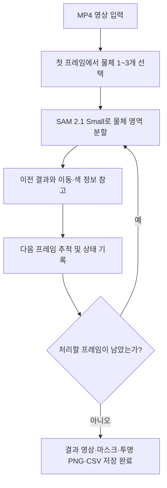
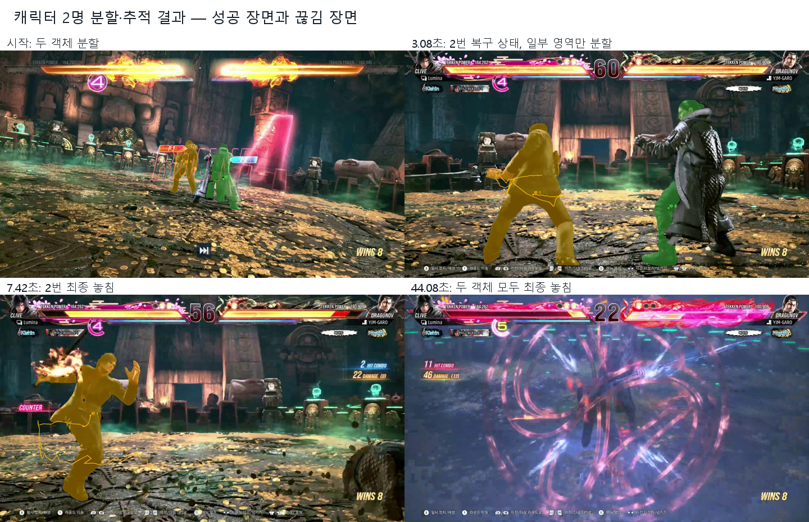
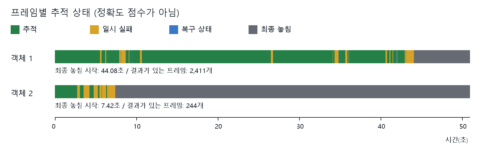
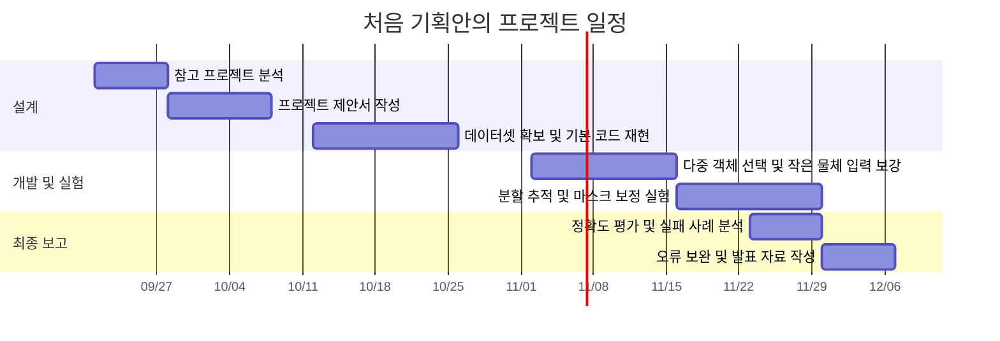

# Project Midterm Report

## 1. 프로젝트 개요 *필수작성

- **프로젝트명:** 사용자 선택 기반 영상 객체 분할·추적 시스템
- **영문명:** User-Guided Video Object Segmentation and Tracking System
- **작성 기준일:** 2026년 10월 30일
- **문서 상태:** 기존 양식을 유지하고 2026년 10월 30일의 캐릭터 2명 실험을 반영한 수정본. 기존 실험과 최신 결과를 구분했으며, 정답 영역을 이용한 정확도 평가는 아직 진행하지 않음.

| 구분 | 성명 | 학번 | 소속학과 | 깃허브 아이디 |
|---|---|---|---|---|
| 1 |박준호|20221703|컴퓨터|praksb2428-maker|

- 지도교수: (소속)　　　　　　(성명)

## 2. 프로젝트 내용

### 2.1 서론

본 프로젝트는 영상에서 사용자가 원하는 물체를 선택하면, 해당 물체의 영역을 분할하고 다음 장면에서도 움직임을 따라가는 프로그램을 만드는 것이다. 특히 화면에서 작게 보이는 물체를 최대 3개까지 선택하고, 물체마다 번호를 유지하며 함께 분할·추적하는 것을 목표로 한다.

처음에는 이미지의 작은 부분까지 분할하는 데 관심을 가졌고, 이를 영상으로 확장해 선택한 물체가 움직일 때도 분할 결과가 이어지도록 주제를 정했다. 영상에서 물체를 매 프레임 직접 잘라내는 작업을 줄이고, 작은 물체를 처리할 때 어떤 어려움이 있는지 확인하고자 한다.

최종 결과물은 Python으로 실행하는 영상 처리 프로그램이다. 사용자가 첫 화면에서 점이나 박스로 물체를 지정하면 SAM 2.1 모델이 물체 영역을 찾고, 이후 프레임의 분할 결과를 이어서 처리한다. 결과는 분할 영역이 표시된 영상, 배경을 제거한 영상, 물체별 투명 PNG 등으로 저장한다. 물체의 움직임은 원본 영상의 움직임을 그대로 유지한다.

현재는 기본 기능을 구현하고, 약 50.9초의 게임 녹화 영상에서 움직이는 캐릭터 2명을 함께 분할·추적했다. 일부 구간에서는 움직임에 맞춰 영역이 이어졌지만 두 객체 모두 영상이 끝나기 전에 추적이 끊겼다. 아주 작은 물체 3개를 끝까지 정확하게 추적하는 목표는 아직 달성하지 못했으며, 실제 촬영 영상과 정답 영역을 이용한 평가가 필요하다.

### 2.2 추진 배경(자료조사 및 요구분석)

#### 2.2.1. 개발 배경 및 필요성 *필수작성

영상에서 원하는 물체만 따로 사용하려면 물체와 배경을 구분해야 한다. 정지 사진에서는 한 번 영역을 표시하면 되지만, 영상에서는 물체나 카메라가 움직이므로 여러 프레임에 걸쳐 영역을 계속 확인해야 한다. 작은 물체는 화면에서 차지하는 픽셀이 적어 위치를 정확히 선택하기 어렵고, 배경과 색이 비슷하거나 다른 물체에 가려지면 추적이 끊길 수 있다.

이 프로젝트에서는 사용자가 분할 대상을 직접 알려주고, 프로그램이 다음 프레임에서도 해당 물체를 찾아 결과를 저장하도록 한다. 예상 사용자는 영상에서 특정 물체를 추출하려는 학생이나 간단한 영상 편집을 하려는 사람이다. 실제 사용자 인터뷰나 설문조사는 아직 진행하지 않았으며, 다음 요구사항은 프로젝트의 사용 목적과 현재 구현 과정에서 정리한 내용이다.

| 요구사항 | 필요한 이유 | 현재 반영 상태 |
|---|---|---|
| 최대 3개 물체를 각각 선택 | 원하는 대상 여러 개를 함께 처리하기 위해 | 구현 |
| 확대 후 점·박스로 선택 | 작은 물체의 위치를 지정하기 위해 | 구현 |
| 물체별 번호 유지 및 추적 | 선택한 물체를 구분하고 움직임을 확인하기 위해 | 구현, 정확도 추가 평가 필요 |
| 배경 제거 및 객체별 저장 | 추출한 물체를 확인하거나 후속 작업에 사용하기 위해 | 구현 |
| 일시적인 추적 실패 기록 및 복구 시도 | 잘못된 배경을 계속 따라가는 문제를 줄이기 위해 | 구현, 최신 2개 객체 실험에서 상태 기록 확인 |
| 결과를 수치로 평가 | 단순히 영상이 저장된 것과 정확한 분할을 구분하기 위해 | 평가 기능 구현, 정답 데이터 준비 필요 |

#### 2.2.2. 선행기술 및 사례 분석 *필수작성

자료조사는 SAM·SAM 2 논문, 공식 코드와 데모 안내, 영상 분할 데이터셋, 공개 특허 문서를 중심으로 진행했다. 아래에서는 자료에서 확인한 내용, 현재 프로그램에 적용한 내용, 앞으로 검토할 내용을 구분한다. 웹 자료의 확인일은 2026년 10월 30일이다.

**모델과 기존 구현 사례**

SAM은 사용자 입력으로 이미지의 분할 대상을 지정하는 모델이다. SAM 2는 이를 영상으로 확장하고 이전 프레임의 정보를 활용한다. 따라서 첫 화면에서 고른 물체를 다음 장면에서도 분할하려는 본 프로젝트의 기반 모델로 사용했다. [SAM 논문](https://arxiv.org/abs/2304.02643), [SAM 2 논문](https://arxiv.org/abs/2408.00714)

| 조사 자료 | 확인한 내용 | 현재 프로젝트와의 연결 |
|---|---|---|
| SAM 2 공식 영상 예측 API | 점·박스 입력, 여러 객체 처리, 분할 결과를 다음 프레임으로 전달하는 기능과 수정 예제 안내 | 현재 SAM 2.1 Small에 객체별 선택 정보와 추적 상태를 전달 |
| SAM 2 공식 웹 데모 | React 기반 화면과 Python 서버로 구성된 공개 데모 | 본 프로젝트는 로컬 Python 선택 창과 파일 저장 기능으로 구성 |
| 초기 참고 Kaggle 노트북 | `SAM2: Traffic Accident Video Seg w/Back Removal`라는 제목의 Python 노트북. 검색으로 확인한 페이지 요약에는 Apache 2.0 표시가 있음 | 영상 분할·배경 제거 사례로 참고. 세부 코드와 연결 데이터셋의 전체 내용은 이번에 확보하지 못함 |
| OpenCV 광학 흐름 문서 | 연속 프레임 사이에서 특징점 이동을 추정하는 Lucas–Kanade 방법 설명 | 현재 코드의 이동 정보 활용을 이해하는 근거 |
| OpenCV 형태학적 연산 문서 | 잡음 제거·구멍 보정에 쓰는 연산과 물체 영역이 줄거나 늘어나는 성질 설명 | 작은 물체의 영역을 지우지 않도록 보정 전후를 비교할 때 참고 |

출처: [SAM 2 공식 저장소의 Video prediction 안내](https://github.com/facebookresearch/sam2#video-prediction), [공식 데모 안내](https://github.com/facebookresearch/sam2/blob/main/demo/README.md), [Kaggle 초기 참고 노트북](https://www.kaggle.com/code/stpeteishii/sam2-traffic-accident-video-seg-w-back-removal/notebook), [OpenCV Optical Flow](https://docs.opencv.org/4.x/d4/dee/tutorial_optical_flow.html), [OpenCV Morphological Transformations](https://docs.opencv.org/4.x/d9/d61/tutorial_py_morphological_ops.html).

다중 객체 처리와 추가 입력은 SAM 2 자체에서 지원한다. 따라서 이러한 기능을 새로 발명했다고 설명하지 않는다. 본 프로젝트에서 직접 구성한 부분은 숫자 1·2·3을 이용한 선택, 작은 물체를 위한 확대, 추적 상태 기록, 객체별 결과 저장이다. 기존 모델을 사용자가 실행할 수 있는 프로그램으로 연결하고 작은 물체의 실패 사례를 확인하는 데 의미를 둔다. 기존 제품보다 우수하다는 비교 실험은 아직 하지 않았다.

Kaggle 노트북의 공개 코드 라이선스 표시를 데이터셋 영상의 사용 허가로 해석하지 않는다. 코드 본문을 읽지 못한 상태이므로, 좌표를 반드시 코드에 직접 써야 한다거나 다중 객체 기능이 없다고 단정하지 않는다. 기술 구현의 확인 가능한 근거는 공식 API 안내를 사용했다.

**기존 기술의 한계와 현재 결과의 연결**

SAM 2 논문의 부록 C는 긴 가림·장시간 영상·복잡한 장면에서 대상이 바뀌거나 사라질 수 있다고 설명한다. 빠르게 움직이는 가느다란 부분과 비슷하게 생긴 물체도 어려운 사례로 제시하며, 오류 프레임에 추가 클릭을 주는 보완 방법을 설명한다. [SAM 2 논문 부록 C](https://arxiv.org/html/2408.00714v2#A3)

우리 프로그램도 일부 프레임에서 빈 결과나 잘못된 배경이 관찰됐다. 논문의 한계가 모든 오류의 원인임을 증명한 것은 아니지만, 가림·빠른 이동·비슷한 배경을 나누어 시험할 필요가 있다는 근거로 참고했다.

| 현재 확인한 문제 | 현재 적용한 처리 | 앞으로 개선할 방향 |
|---|---|---|
| 물체가 움직이면 이전 위치와 달라져 결과가 끊김 | 특징점 이동과 이전 유효 영역을 함께 참고 | 빠른 이동 장면을 따로 평가하고 실패 구간 확인 |
| 배경이나 손이 대상에 섞이는 경우 | 전체 화면 정보를 유지하고 초기 색·면적을 확인 | 조명 변화 때 실제 대상도 제외되는지 조사하고 판정 기준 비교 |
| 최신 2개 객체 실험에서 일시 실패와 최종 놓침 발생 | 최대 60프레임 동안 복구 시도, 상태 기록 | 실제로 보이는 대상의 실패와 가림을 구분하고, 동일 객체로 복구됐는지 확인 |
| 첫 프레임 이후 사용자가 선택을 고칠 수 없음 | 현재는 첫 프레임 선택만 제공 | 오류 프레임에서 점·박스로 같은 객체를 다시 지정하는 기능을 우선 검토 |
| 추적 상태만으로 경계 정확도를 알 수 없음 | 평가 명령은 구현했으나 정답 비교 미수행 | 정답 영역으로 IoU·Dice 측정, 보정 전후 비교 |

이 표의 현재 결과는 2.3.5의 내부 시험 기록이고, 마지막 열은 이번 조사로 정리한 향후 작업이다. 아직 추가 기능을 구현하거나 개선 효과를 측정한 것으로 표시하지 않는다.

**관련 특허 조사**

`interactive video segmentation`, `video segmentation user input` 등을 검색어로 공개 특허의 명세서와 청구항을 확인했다. 다음 두 문서는 사용자 선택과 프레임 간 영역 전달이 이미 다뤄진 기술임을 보여 주는 비교 자료다.

| 공개 문서 | 공개된 기술 내용 | 우리 프로젝트와의 공통점·차이 |
|---|---|---|
| [WO2016016033A1](https://patents.google.com/patent/WO2016016033A1/en), 「Method and apparatus for interactive video segmentation」, 2016-02-04 공개 | 청구항 1은 시간적으로 이어지는 작은 영상 영역인 슈퍼픽셀의 선택과 마스크 생성, 5·8은 이후 프레임의 수정과 저장을 설명 | 사용자가 영역을 고르고 영상에 전달한다는 목적은 비슷함. 현재 프로그램은 슈퍼픽셀 선택 방식 대신 SAM 2.1의 점·박스와 마스크를 사용 |
| [US20200160528A1](https://patents.google.com/patent/US20200160528A1/en), 고화질 대화형 영상 분할 관련 문서, 2020-05-21 공개 | 명세서는 영상을 나눠 특징을 얻는 방식 등을 설명하며, 청구항 1·4는 현재·이전 프레임 및 분할 정보를 CNN에 결합하는 구성을 다룸 | 과거 정보와 사용자 지정을 이용한다는 공통점이 있음. 현재 프로그램은 해당 CNN 구조를 별도로 구현하지 않고 공개 SAM 2.1과 추적 보조 코드를 사용 |

첫 문서는 공개 명세서·청구항을, 두 번째 문서는 공개 내용과 등록공보 `US11928753B2`의 연결을 확인했다. 조사한 기술의 참고점은 사용자 수정과 프레임 간 정보 활용이며, 특허의 구체적인 모델 구조를 복제하는 계획은 세우지 않았다. 이 비교는 기술 조사 범위이다. 공개 문서의 열람만으로 자유로운 사용이나 비침해를 확인한 것은 아니며, 국가별 유효 권리와 현재 구현의 청구항 해당 여부는 확정하지 않았다.

**평가 데이터 자료조사**

| 자료 | 조사 결과 | 활용 방향 및 확인할 점 |
|---|---|---|
| 처음 기획안의 Real-Time Traffic Accidents Dataset | 과거 로컬 다운로드 기록에서 `car/accident/1.mp4` 확보 이력을 확인. 현재 웹 본문·전체 구성·이용 조건은 확인하지 못함 | 교통 영상 사례로 검토하되 현재 게임 영상의 출처와 혼동하지 않음 |
| DAVIS 2017 | 공식 페이지에 다중 객체 분할 자료와 TrainVal의 이미지·정답 영역 다운로드가 안내됨 | 정답 비교용 후보. 물체가 작게 보이는 장면과 객체 수를 확인한 뒤 일부 장면 선정 |
| MOSE v1 | 작은 대상, 심한 가림, 사라짐·재등장 등 복잡한 장면을 다루는 자료 | 어려운 장면의 추가 시험 후보. 검증 세트는 첫 프레임 정답만 공개하므로 로컬 전체 프레임 평가 가능 여부를 별도로 확인 |
| 직접 촬영한 영상 | 아직 새로 촬영하지 않음 | 작은 물체 3개의 이동·가림·조명 조건을 조절하고 정답 영역을 직접 작성할 계획 |

출처: [기획안의 Kaggle 데이터셋 주소](https://www.kaggle.com/datasets/islamalattar/real-time-traffic-accidents), [DAVIS 공식 소개](https://davischallenge.org/), [DAVIS 2017 다운로드 안내](https://davischallenge.org/davis2017/code.html), [MOSE 논문](https://arxiv.org/abs/2302.01872), [MOSE v1 공식 안내](https://mose.video/MOSEv1/). 과거 Kaggle 다운로드 이력은 내부 기록이며 이번에 웹에서 다시 검증한 정보가 아니다.

DAVIS 2017은 기본적인 정답 비교, MOSE는 복잡한 가림 상황을 살펴보는 후보로 구분한다. MOSE v1 공식 안내는 CC BY-NC-SA 4.0과 비상업적 연구 목적을 명시한다. DAVIS와 Kaggle은 사용할 파일의 조건을 추가 확인한다. 이번 작업에서는 데이터셋을 새로 다운로드하거나 평가 서버에 영상을 올리지 않았다.

### 2.3 목표 및 내용

#### 2.3.1. 프로젝트 목표 *필수작성

1. 사용자가 영상의 첫 프레임에서 물체를 1~3개 선택할 수 있도록 한다.
2. 작은 물체를 확대해 선택하고, 각 물체를 구분해 분할·추적한다.
3. 일시적으로 인식에 실패하면 이를 기록하고, 일정 프레임 동안 같은 객체의 복구를 시도한다.
4. 분할 표시 영상, 배경 제거 영상, 객체별 마스크와 투명 PNG를 저장한다.
5. 사람이 표시한 정답 영역을 준비해 분할 정확도와 추적 실패를 평가한다.

1~4번의 기능은 구현했으며, 모든 상황에서의 정확도는 추가 확인이 필요하다. 5번은 평가 기능을 구현했지만 정답 영역을 이용한 실제 정확도 측정은 아직 진행하지 않았다. 작은 물체 3개를 놓치지 않고 지속적으로 정확하게 추적하는 것은 최종 목표이며, 현재 달성했다고 볼 수는 없다.

#### 2.3.2. 개발 내용 *필수작성

**최종 결과물의 형태와 사용 방법**

Windows에서 실행하는 Python 프로그램이며, VS Code에서 `main.py`를 실행할 수 있다. 입력은 MP4 영상이고, 첫 프레임에서 사용자가 대상 물체를 지정한다. 현재 기본 실행은 입력 영상의 앞 60초까지 처리하도록 설정되어 있다. 이는 처리할 영상 길이이며, 프로그램이 60초 안에 끝난다는 뜻은 아니다. 최신 실험은 60fps 영상의 3,054프레임, 약 50.9초를 처리했다. 다만 전체 파일 저장 완료와 모든 객체의 추적 성공은 구분한다.

| 조작 | 기능 |
|---|---|
| 숫자 1·2·3 | 선택하거나 수정할 물체 번호 변경 |
| 왼쪽 클릭 | 물체에 포함할 지점 지정 |
| 왼쪽 드래그 | 물체를 둘러싸는 박스 지정 |
| 오른쪽 클릭 | 제외할 배경 지점 지정 |
| 마우스 휠 | 화면 확대·축소 |
| Enter | 선택 완료 후 분할·추적 시작 |

**시스템 구성**

처리 흐름은 ‘영상 입력 → 대상 선택 → 분할 → 프레임별 추적 → 결과 저장’이다. 다이어그램의 반복 분할 단계에서는 첫 선택 정보와 이어받은 추적 상태를 사용하며, 매 프레임 사용자가 다시 선택하는 것은 아니다.

기본 연속 추적 방식은 48개 출력 프레임씩 처리하고, 다음 구간에 물체별 마지막 유효 영역과 해당 프레임을 전달한다. 기본 설정에서는 복구용 과거 프레임을 포함해 한 구간에 최대 108프레임을 모델 입력으로 사용한다. 이 값은 전체 GPU 메모리 사용량의 상한을 뜻하지 않는다.

이전 영역과 현재 결과를 비교할 때 물체 안의 특징점 이동을 참고한다. 이를 광학 흐름이라고 하며, 프레임 사이에서 물체가 어느 방향으로 움직였는지 추정하는 데 사용한다. 이동시킨 이전 영역 자체를 새 분할 결과로 저장하지 않고, SAM이 실제로 출력한 영역 중에서 결과를 선택한다. 처음 채택한 물체의 색 분포와 크게 다른 결과는 잘못 따라간 영역일 가능성이 있어 제외한다.

인식에 실패하면 빈 마스크와 `missing` 상태를 기록한다. 기본 설정에서는 최대 60프레임 동안 복구를 시도하고, 다시 인식하면 `recovered`로 기록한다. 연속 실패가 한도에 도달하면 `lost`로 처리한다. 이 상태 이후의 자동 재발견이나 보이지 않는 부분을 그려 넣는 기능은 없다.

**사용 모델과 데이터**

| 구분 | 내용 |
|---|---|
| 사용 모델 | 사전 학습된 SAM 2.1 Small |
| 학습·파인튜닝 | 현재 수행하지 않음 |
| 모델 입력 | 영상 프레임과 사용자가 지정한 점·박스, 이어받은 추적 정보 |
| 모델 출력 | 물체별 분할 마스크. 물체 영역과 배경을 구분한 이미지 |
| 최신 시험 영상 | 게임 캐릭터 2명이 움직이는 녹화 영상. 원본과 저장 기록의 파일 해시 일치 확인 |
| 원본 영상 규격 | 1920×1080, 60fps, 3,054프레임, 약 50.9초 |
| 최신 시험 구간 | 첫 프레임부터 전체 3,054프레임, 약 50.9초 |
| 시험 대상 | 첫 프레임에서 선택한 게임 캐릭터 2명. 이전 장식물 3개 실험과 구분 |
| 정답 영역 데이터 | 아직 준비하지 않음 |

**기획안의 모델 학습 계획과 현재 구현의 구분:** GitHub에 보관된 기획안에는 SAM 2.1 Hiera Base+를 교통 영상으로 파인튜닝하고 학습 전후를 비교하는 계획이 있다. 이번 중간보고서에서 확인한 구현과 실험은 사전 학습된 Small 모델을 사용한 분할·추적 단계이다. Base+ 파인튜닝, 학습용 정답 마스크 제작, 학습 전후 정확도 비교를 완료한 것으로 보고하지 않는다.

최신 시험에서는 카메라 움직임뿐 아니라 캐릭터 자체의 동작이 있는 장면을 사용했다. 첫 프레임에서 채택된 영역은 1번 22,248픽셀, 2번 26,689픽셀로 화면의 약 1.07%, 1.29%이다. 이는 모델이 출력한 영역의 크기이며 실제 몸 전체의 정답 면적은 아니다. 따라서 이번 결과만으로 아주 작은 물체 3개의 동시 추적 성능을 입증하지 않는다. 이 영상은 학습이나 파인튜닝에 사용하지 않았다.

기획안에서 정한 Kaggle 자료는 별도로 구분한다. 2026년 10월 12일의 `sample-kaggle-source.json`에는 데이터셋 버전 1의 `car/accident/1.mp4`를 내려받았다는 기록이 있다. 기록상 규격은 1280×720, 30fps, 113프레임이고, SHA-256은 `ad73c0075d2e9f4de3203096b06b10180f377e2a07b12cddea0611ecaf7aa3d2`이다. 최신 실험 입력으로 확인한 게임 영상의 SHA-256은 `c559f5ea642d46c8cd2aa3ed36f3bd232d20b1fe242ba6dfcf31865ffc5411c5`로 서로 다르다. 따라서 과거 Kaggle 다운로드 기록과 현재 게임 영상의 실험 결과를 같은 자료의 결과로 합치지 않는다. 과거 파일의 현재 보관 여부와 사용 허가까지 확인한 것은 아니다.

다음 평가에서는 직접 촬영 영상과 2.2.2에서 조사한 DAVIS 2017 등을 후보로 검토한다. 공개 자료의 이미지 프레임을 MP4로 묶는 경우 순서·해상도·정답 프레임 번호를 유지하고, 객체 ID가 담긴 정답 PNG는 평가할 객체별 0·255 마스크로 변환해야 한다. 데이터 변환과 정답 대응은 아직 수행하지 않았다. MOSE v1 검증 세트처럼 전체 정답이 공개되지 않은 경우에는 바로 로컬 IoU를 계산할 수 없으므로, 정답이 제공되는 자료나 직접 표시한 영역을 사용한다.

작은 물체의 크기는 영상에서 차지하는 픽셀 면적과 화면 대비 비율로 기록한다. 같은 장면에서도 멀어지거나 가려지면 보이는 면적이 달라지므로, 크기만으로 인식 실패의 원인을 단정하지 않는다.

**저장 결과와 개발 범위**

| 결과 파일 | 내용 |
|---|---|
| `overlay.mp4` | 원본 위에 분할 영역과 객체 번호를 표시한 영상 |
| `foreground.mp4` | 선택한 물체만 남기고 배경을 검정으로 처리한 영상 |
| `masks` | 객체별 분할 영역을 표시한 PNG |
| `transparent` | 배경이 투명한 객체별 PNG |
| `tracking_status.csv` | 객체별 추적·일시 실패·복구·놓침 상태 |
| `centroids.csv` | 물체의 중심 위치와 면적 |

MP4 자체를 투명 배경으로 저장하는 방식은 아니며, 투명 결과는 PNG로 저장한다. 현재는 영상 파일 처리가 범위이고, 실시간 카메라 입력·중간 프레임에서 선택 수정·새 배경 합성·새 움직임 생성·원래 음성 보존은 포함하지 않았다.

#### 2.3.4. 개발 환경

| 구분 | 사용 환경 |
|---|---|
| 운영체제 | Windows |
| 개발 도구 | Visual Studio Code |
| 언어 | Python 3.12.1 |
| 딥러닝 프레임워크 | PyTorch 2.7.1+cu128 |
| 영상 처리 | OpenCV 4.12.0.88 |
| 배열 처리 | NumPy 2.2.6 |
| 모델 | SAM 2.1 Small, 공개된 사전 학습 가중치 |
| GPU | NVIDIA GeForce RTX 3060, VRAM 12GB |
| 실행 환경 | 프로젝트 전용 Python 가상환경 `.venv`, CUDA 추론 |

위 환경은 현재 개발 PC 기준이다. 모델을 새로 학습하는 환경을 구성한 것은 아니며, 학습된 모델로 영상을 처리하는 추론 환경이다. 다른 PC에서 실행할 경우 Python 패키지와 GPU 드라이버의 호환성을 확인해야 한다.

#### 2.3.5. 결과 *필수작성

**현재까지 진행한 내용**

| 항목 | 진행 결과 | 확인 범위 |
|---|---|---|
| 기본 실행과 선택 | VS Code에서 실행하고 최대 3개 물체를 번호별로 선택하도록 구현 | 최신 저장 선택 파일에는 캐릭터 2개가 등록됨. 이번 보고서 수정에서 마우스 조작 전 과정을 다시 재현하지는 않음 |
| 분할·추적 | 사전 학습된 SAM 2.1 Small로 움직이는 캐릭터 2명을 함께 처리 | 1920×1080, 60fps, 3,054프레임의 완료 기록과 영상 확인 |
| 일시 실패와 복구 기록 | 빈 결과를 기록하고 최대 60프레임 동안 복구 시도 | 1번에서 복구 상태 21프레임, 2번에서 6프레임 기록 |
| 결과 저장 | 분할 표시 영상, 배경 제거 영상, 객체별 PNG와 CSV 저장 | 두 결과 영상의 전체 프레임 디코딩 및 파일 개수 확인 |
| 기존 코드 검사 | 2026년 10월 29일 보고서에 신규 15개·기존 67개, 총 82개 통과 기록 | 과거 검사 기록을 구분해 인용. 이번 문서 수정에서 코드 검사를 다시 실행한 것은 아님 |

**최신 실험 방법**

첫 프레임에서 1번과 2번 캐릭터를 각각 박스로 지정하고 처리를 시작했다. 작은 물체 추적 모드, 이동 경로 표시, 투명 PNG 저장을 사용했으며, 사전 학습된 Small 모델을 GPU로 실행했다. 마스크 구멍 보정과 작은 영역 제거는 꺼진 상태였다. 이 실험은 프로그램으로 전체 영상을 처리할 수 있는지와 움직이는 두 대상의 분할이 이어지는지를 확인하는 시험이다.

| 조건 | 내용 |
|---|---|
| 영상 | 게임 녹화 영상, 약 50.9초 |
| 규격 | 1920×1080, 60fps, 3,054프레임 |
| 선택 대상 | 게임 캐릭터 2명 |
| 모델과 처리 방식 | SAM 2.1 Small, CUDA, 전체 화면 기반 연속 추적 |
| 처리 시간 기록 | 약 29분 12초. `run.json`에 기록된 프레임 추출부터 저장 확인까지의 시간이며 모델 로딩 시간은 제외 |
| 정답 영역 | 미작성. IoU·Dice 측정하지 않음 |

**객체별 추적 기록**

아래 수치는 `tracking_status.csv`의 6,108행을 객체별로 집계한 결과다. 각 행은 한 프레임의 한 객체 상태를 나타내며, 객체마다 네 상태의 합은 3,054프레임이다.

| 객체 | 추적 `tracked` | 일시 실패 `missing` | 복구 `recovered` | 최종 놓침 `lost` |
|---|---:|---:|---:|---:|
| 1번 캐릭터 | 2,390 | 234 | 21 | 409 |
| 2번 캐릭터 | 238 | 201 | 6 | 2,609 |

`recovered`는 프로그램이 복구 상태를 기록한 프레임 수이며, 같은 대상을 정확하게 되찾았다고 사람이 확인한 횟수는 아니다. 비어 있지 않은 결과는 `tracked`와 `recovered`를 합쳐 1번 2,411프레임, 2번 244프레임이다. 이 수치를 정확도나 성공률로 해석하지 않는다.

1번의 마지막 비어 있지 않은 결과는 2,585번 프레임(약 43.08초), 2번은 385번 프레임(약 6.42초)이다. 이후 60프레임 연속 실패하면서 각각 2,645번 프레임(약 44.08초), 445번 프레임(약 7.42초)에 최종 놓침 상태가 시작됐다. 최종 놓침 시각까지 계속 정상 추적됐다는 뜻은 아니며, 그 전에 일시 실패와 복구가 반복됐다. 프레임 번호는 0부터 시작한다.

*그림 1. 최신 캐릭터 2명 실험의 일부 결과. 0번 프레임에서는 두 대상이 분할되지만, 185번 프레임의 2번은 몸 전체 대신 일부 영역만 표시된다. 445번 프레임에는 2번 결과가 사라지고, 2,645번 프레임에는 두 객체 모두 결과가 비어 있다. 이동 경로 선은 이전 위치의 기록이며 현재 분할 영역은 아니다.*

*그림 2. CSV에서 정리한 객체별 상태 변화. 상태는 프로그램의 판단 기록이며 정답 영역과 비교한 정확도 점수가 아니다.*

**확인한 점과 해석**

- 시작 장면과 일부 이동 장면에서 선택한 캐릭터의 위치에 맞춰 분할 영역이 움직이는 것을 확인했다.
- 일부 프레임에서는 대상의 몸 일부만 분할됐다. `tracked` 또는 `recovered`로 기록돼도 몸 전체의 경계가 정확하다고 볼 수 없다.
- 두 객체 모두 최종 놓침이 발생했다. 화면에 대상이 없어서 결과가 빈 경우와, 보이는데 인식하지 못한 경우를 모든 프레임에서 구분한 것은 아니다.
- `overlay.mp4`와 `foreground.mp4`는 각각 3,054프레임으로 끝까지 디코딩됐다. 객체별 `masks`, `masks_raw`, `transparent` 폴더도 각 3,054개 PNG가 있는지 확인했다. 7개 표본 프레임에서는 마스크와 투명 PNG의 크기·알파 채널·기록 면적이 맞는지 검사했다. 전체 PNG의 픽셀 정확도를 검증한 것은 아니다.
- 이번 수정에서는 저장된 영상을 검사하고 기록을 정리했다. 새 모델 학습이나 추적 코드 변경에 따른 성능 향상을 확인한 실험은 아니다.

이전 보고서의 장식물 3개·3초 실험은 과거 기본 기능 시험으로 구분한다. 최신 시험은 대상 수, 선택 좌표, 영상 길이가 다르므로 과거 수치와 직접 비교해 개선됐다고 판단하지 않는다. 교통 영상 3대 실험은 별도의 과거 시험이며, 관련 결과 폴더를 현재 위치에서 찾지 못해 이번 주요 결과 표에는 합치지 않았다.

**남아 있는 문제**

- 일시 실패 뒤에도 같은 대상을 다시 찾도록 복구 기능을 개선해야 한다.
- 몸 일부만 분할하거나 배경을 포함하는 경우를 구분해 확인해야 한다.
- 빠른 이동·가림·색 변화가 각각 어떤 영향을 주는지 같은 조건에서 비교해야 한다.
- 현재 결과는 게임 캐릭터 2명 시험이다. 실제 영상의 아주 작은 물체 3개를 끝까지 추적하는 평가는 추가로 필요하다.
- 사람이 작성한 정답 영역으로 IoU·Dice를 측정해야 하며, 처리 시간 단축과 더 긴 영상의 안정성도 따로 확인해야 한다.

### 2.4 기대효과

이 프로그램은 영상에서 필요한 물체를 선택하고 분리해 확인하는 데 도움을 줄 수 있다. 여러 물체의 결과를 따로 저장할 수 있어 간단한 편집 자료나 영상 분석 실습에 활용할 수 있을 것으로 기대한다. 다만 실제 작업 시간이나 비용이 얼마나 줄어드는지는 아직 측정하지 않았다.

학습 측면에서는 사용자 입력이 모델에 어떻게 전달되는지, 영상에서 이전 정보를 어떻게 이어 쓰는지, 작은 물체와 가림이 분할에 어떤 영향을 주는지 이해할 수 있다. 결과가 저장되는 것과 정확하게 분할되는 것을 구분하고 직접 평가해 본다는 점에도 의미가 있다.

### 2.5 향후 계획 (프로젝트 일정) *필수작성

일정은 처음 기획안에서 만든 간트차트의 날짜를 유지하고, 2026년 10월 30일 기준의 실제 진행 상태를 함께 정리했다. 지난 날짜라는 이유만으로 작업을 완료 처리하지 않았다. 담당자 이름은 작성자가 역할 분담을 입력한 뒤 연결한다.

| 원래 기간 | 계획한 작업 | 현재 진행 상태 | 남은 작업 |
|---|---|---|---|
| 9월 21일~9월 27일 | 참고 프로젝트 분석 | 초기 참고 자료 선정 후 이번 보고서에서 공식 자료·특허 조사를 보완 | Kaggle 세부 코드·자료 조건 확인 |
| 9월 28일~10월 7일 | 프로젝트 제안서 작성 | 기획안 작성됨 | 데이터와 실제 구현의 차이 설명 유지 |
| 10월 12일~10월 25일 | 데이터셋 확보 및 기본 코드 재현 | 실행 환경·모델 실행 구현, 과거 Kaggle 영상 다운로드 기록 존재 | 전체 데이터셋·현재 보관·이용 조건 및 참고 노트북 재현 여부 확인 |
| 11월 2일~11월 15일 | 다중 객체 선택 및 작은 물체 입력 보강 | 최대 3개 선택·확대 기능을 미리 구현 | 사용자가 직접 조작하는 전체 과정 재확인, 평가 영상 확정 |
| 11월 16일~11월 29일 | 분할·추적 및 마스크 보정 실험 | 기존 짧은 구간 시험에 이어 캐릭터 2명·약 50.9초 실험을 진행 | 실제 작은 물체 3개, 이동·가림·색 변화별 비교, 보정 전후 평가, 수정 입력 기능 검토 |
| 11월 23일~11월 29일 | 정확도 평가 및 실패 사례 분석 | 최신 실험의 상태 기록과 일부 분할·놓침 장면 확인. 정답 기반 평가 미진행 | 보이는 대상의 실패와 실제 가림을 구분하고, 정답 작성·IoU·Dice·복구 결과 분석 |
| 11월 30일~12월 6일 | 오류 보완 및 발표 자료 작성 | 최종 정리 전 | 개선 결과·한계 정리, 시연 및 발표 자료 작성 |

위 차트는 원래 계획한 기간이고 현재 달성 여부는 표에서 구분했다. 일부 기능을 미리 구현했어도 정답 비교나 실제 환경 검증까지 완료한 것은 아니다. 최종 구간의 종료일은 시작일을 포함해 2026년 12월 6일이다.

**자료조사를 바탕으로 정한 다음 작업**

1. **평가 자료 확정:** 실제 작은 물체 3개가 움직이는 영상을 준비한다. DAVIS 2017 같은 정답 제공 자료와 직접 촬영 영상을 후보로 검토하고, 최종 파일의 출처·사용 조건·객체 수·해상도·크기를 기록한다. 데이터셋 전체 수집이나 모델 재학습을 먼저 진행하지 않는다.
2. **현재 결과부터 측정:** 최신 캐릭터 2명 실험에서 몸 일부만 분할된 장면과 최종 놓침 전후를 먼저 확인한다. 기본 이동·빠른 이동·가림·비슷한 배경·조명 변화를 구분해 프레임을 선정한다. 사람이 확인한 정답 영역으로 IoU·Dice를 계산하고, 물체가 실제로 보이는 프레임과 완전히 가려진 프레임의 결과를 따로 확인한다. 크기와 프레임 선정 기준을 정한 뒤 결과가 좋지 않은 장면도 남긴다.
3. **보정 효과 비교:** 같은 영상·선택 좌표·모델을 사용해 구멍 보정과 작은 영역 제거를 끈 결과와 켠 결과를 비교한다. 잡음이 줄어도 물체 일부를 지우면 개선으로 판단하지 않는다. 광학 흐름·색 검사에 의한 제외도 실패 장면별로 확인한다.
4. **중간 프레임 수정 검토:** SAM 2 논문과 공식 API의 추가 입력 방식을 참고해, 사용자가 오류 프레임에서 같은 번호의 객체에 점이나 박스를 다시 주는 기능을 개선 후보로 둔다. 현재 GUI에는 없으며, 구현할 경우 앞뒤 구간의 객체 번호와 결과 연결을 함께 시험한다.
5. **추적 실패와 복구 확인:** 빈 마스크 횟수뿐 아니라 실제 다른 대상을 따라간 횟수, 가림 뒤 돌아온 동일 객체를 다시 찾았는지, 복구까지 걸린 프레임 수를 기록한다. 현재의 `tracked` 표시는 정답 판정이 아니므로 시각 확인과 정답 비교를 함께 한다.

정확도 측정은 11월 23일 평가 기간에 정답 자료를 사용할 수 있도록 앞선 실험 기간에 준비한다. 수정 입력은 우선 검토할 후보이며, 모든 후보 기능의 구현을 확정한 것은 아니다. 이번 중간보고서 수정에서는 저장된 최신 결과 영상과 CSV를 검사하고 문서를 보완했다. 프로그램 코드 수정·파인튜닝·추가 모델 추론은 수행하지 않았다.

### 2.6 역할 분담

성명과 실제 담당은 작성자가 팀 구성에 맞게 입력한다. 아래 업무는 분담을 위한 제안이며 특정 구성원에게 배정된 상태는 아니다. 개인 프로젝트라면 한 사람이 전체 업무를 담당하도록 정리한다.

| 구분 | 성명 | 팀내 역할 |
|:---:|:---:|---|
| 1 |박준호|제작, 실행, 검증|

필요한 업무는 모델·프로그램 개발, 영상·정답 데이터 준비와 평가, 선행자료 조사와 보고서·발표 정리이다. 실제 분담 시 2.5의 일정과 담당자를 함께 맞춘다.

### 2.7 참고문헌

웹 자료의 확인일은 2026년 10월 30일이다. 논문·공식 문서·공개 특허의 설명과 프로젝트 내부 실험 기록을 구분해 사용했다.

1. Alexander Kirillov 외, 「Segment Anything」, arXiv:2304.02643, 2023. [논문](https://arxiv.org/abs/2304.02643).
2. Nikhila Ravi 외, 「SAM 2: Segment Anything in Images and Videos」, arXiv:2408.00714, 2024. [논문](https://arxiv.org/abs/2408.00714), [부록 C: 한계와 추가 입력](https://arxiv.org/html/2408.00714v2#A3).
3. Meta FAIR, 「SAM 2 공식 저장소」, GitHub. [영상 예측 API·공개 모델 안내](https://github.com/facebookresearch/sam2#video-prediction). 현재 설치는 커밋 `2b90b9f5ceec907a1c18123530e92e794ad901a4` 기준이며, 자료조사로 설치 버전을 변경하지 않았다.
4. Meta FAIR, 「SAM 2 Demo」, GitHub. [공식 데모 구조 안내](https://github.com/facebookresearch/sam2/blob/main/demo/README.md). 문서 비교만 수행했으며 웹 데모를 실제 실행해 성능을 측정한 것은 아니다.
5. stpeteishii, 「SAM2: Traffic Accident Video Seg w/Back Removal」, Kaggle. [노트북 페이지](https://www.kaggle.com/code/stpeteishii/sam2-traffic-accident-video-seg-w-back-removal/notebook). 검색으로 확인한 페이지 요약만 사용했으며 코드 본문 분석은 보류했다.
6. OpenCV, 「Optical Flow」. [공식 문서](https://docs.opencv.org/4.x/d4/dee/tutorial_optical_flow.html). 조회 시 문서는 4.13.0으로 연결되었고, 프로젝트의 실제 OpenCV는 4.12.0.88이다. 알고리즘 개념 설명에 사용했다.
7. OpenCV, 「Morphological Transformations」. [공식 문서](https://docs.opencv.org/4.x/d9/d61/tutorial_py_morphological_ops.html). 보정 연산의 성질을 참고했으며 현재 보정 코드와 동일한 구현이라고 주장하지 않는다.
8. Joern Jachalsky·Andrej Schewzow, 「Method and apparatus for interactive video segmentation」, WO2016016033A1, 공개일 2016-02-04. [공개 명세서·청구항](https://patents.google.com/patent/WO2016016033A1/en).
9. Anthony Rhodes·Manan Goel, 「High fidelity interactive segmentation for video data with deep convolutional tessellations and context aware skip connections」, US20200160528A1, 공개일 2020-05-21. [공개 명세서·청구항](https://patents.google.com/patent/US20200160528A1/en).
10. Jordi Pont-Tuset 외, 「The 2017 DAVIS Challenge on Video Object Segmentation」, arXiv:1704.00675, 2017. [논문](https://arxiv.org/abs/1704.00675), [공식 소개](https://davischallenge.org/), [이미지·정답 다운로드 안내](https://davischallenge.org/davis2017/code.html).
11. Henghui Ding 외, 「MOSE: A New Dataset for Video Object Segmentation in Complex Scenes」, ICCV, 2023. [논문](https://arxiv.org/abs/2302.01872), [MOSE v1 공식 안내](https://mose.video/MOSEv1/). 후속 MOSE v2와 구분해 조사했다.
12. islamalattar, 「Real-Time Traffic Accidents Dataset」, Kaggle, 초기 기획안의 후보. [원래 데이터셋 주소](https://www.kaggle.com/datasets/islamalattar/real-time-traffic-accidents). 현재 본문·전체 구성·사용 조건은 미확인이다. 내부 보존 파일 `sample-kaggle-source.json`(개발 기록에 별도 보관)의 과거 다운로드 기록을 별도로 확인했다. 웹에서 이번에 전체 데이터를 확인한 것으로 사용하지 않았다.
13. 본 프로젝트, 「로컬 프로그램 실행 안내 및 기능 범위」, 개발 폴더의 `README.md`(내부 개발 문서, 이 저장소에는 별도 수록하지 않음).
14. 본 프로젝트, 「기존 소형 객체 검증 기록」, 2026년 10월 29일. 이전 중간보고서와 보존 검증 문서의 과거 코드 검사·기본 기능 시험 이력으로만 사용했다. 최신 캐릭터 2명 실험과 합산하거나 같은 조건의 비교 결과로 해석하지 않았다.
15. 본 프로젝트, 「프로젝트 제안서·개발 일정」, 2026년 10월 5일 작성 기획안의 보존본과 Excel 일정. 일정은 저장소의 [기존 기획안](https://github.com/praksb2428-maker/Custom_object_segmentation_in_the_video/blob/1b15024f8eab15f3d5d4a93eaaa607181f6e7304/User-Selected%20Object%20Segmentation%20and%20Tracking%20System%20for%20Videos.md)과 [원래 간트차트](https://github.com/praksb2428-maker/Custom_object_segmentation_in_the_video/blob/1b15024f8eab15f3d5d4a93eaaa607181f6e7304/Weekly%20Plan.png)를 함께 참고했다. 기간은 시작일과 종료일을 모두 포함한다.
16. 본 프로젝트, 「캐릭터 2명 전체 영상 실험」, 2026년 10월 30일. 최신 결과 폴더 `outputs/selected-c5cc165218704e7789d1b1cb8b5d1b05/`의 `run.json`, `prompts.json`, `tracking_status.csv`, `centroids.csv`, 결과 영상과 PNG를 확인했다. 문서 수정 시의 집계·디코딩 검사는 `reports/review/experiment-update-20261030/latest-run-qa.json`에 별도 보관한다. 영상은 게임 녹화 시험 자료이며 Kaggle 교통 데이터셋의 영상으로 표기하지 않았다.
