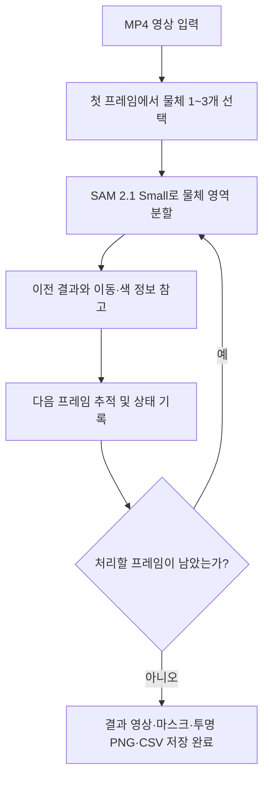
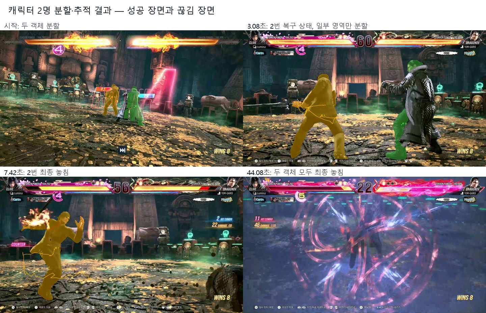
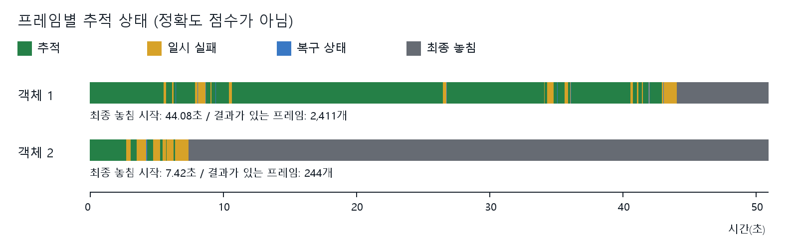
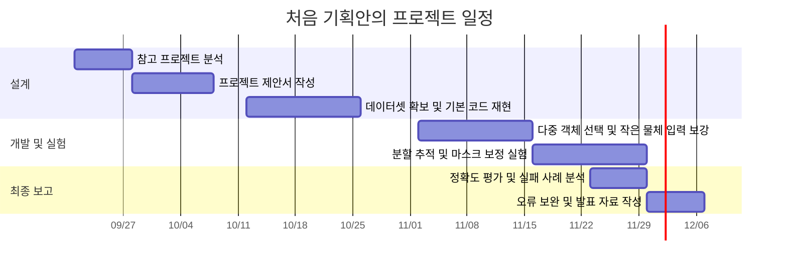

# 1. 프로젝트 개요

## 1.1. 기본 정보

- 프로젝트 제목 : 사용자 선택 기반 영상 객체 분할·추적 시스템
- **영문명:** User-Guided Video Object Segmentation and Tracking System
- 작성일자 : 2026년 11월 16일
- 실험 내용 기준일 : 2026년 11월 15일
- **실험 코드 기준:** 11월 15일 개발 PC에서 검증한 개선 코드를 GitHub 프로그램에도 반영했다. 입력 영상·모델 가중치·가상환경·실행 결과는 저장소에 포함하지 않으며 별도로 준비한다.
- 문서 상태 : 제공된 `mid-report.md` 양식에 맞춰 항목과 순서를 재구성했다. 기존 실험 수치와 한계는 유지했으며, 11월 16일에 새 실험을 수행한 결과는 아니다.

| 구분 | 성명 | 학번 | 소속학과 | 깃허브 아이디 |
|---|---|---|---|---|
| 1 |박준호|20221703|컴퓨터|praksb2428-maker|

- 지도교수: (소속)　　　　　　(성명)

**프로젝트 설명**

본 프로젝트는 영상에서 사용자가 원하는 물체를 선택하면, 해당 물체의 영역을 분할하고 다음 장면에서도 움직임을 따라가는 프로그램을 만드는 것이다. 특히 화면에서 작게 보이는 물체를 최대 3개까지 선택하고, 물체마다 번호를 유지하며 함께 분할·추적하는 것을 목표로 한다.

처음에는 이미지의 작은 부분까지 분할하는 데 관심을 가졌고, 이를 영상으로 확장해 선택한 물체가 움직일 때도 분할 결과가 이어지도록 주제를 정했다. 영상에서 물체를 매 프레임 직접 잘라내는 작업을 줄이고, 작은 물체를 처리할 때 어떤 어려움이 있는지 확인하고자 한다.

최종 결과물은 Python으로 실행하는 영상 처리 프로그램이다. 사용자가 첫 화면에서 점이나 박스로 물체를 지정하면 SAM 2.1 모델이 물체 영역을 찾고, 이후 프레임의 분할 결과를 이어서 처리한다. 결과는 분할 영역이 표시된 영상, 배경을 제거한 영상, 물체별 투명 PNG 등으로 저장한다. 물체의 움직임은 원본 영상의 움직임을 그대로 유지한다.

기본 기능 구현 후 10월 30일에는 약 50.9초의 게임 영상에서 캐릭터 2명을 처리했고, 두 대상 모두 영상이 끝나기 전에 추적이 끊기는 문제를 확인했다. 11월 15일에는 색·크기 변화 대응, 가림 뒤 재탐색, 작은 영역 재분할과 구간 기준 마스크 보정을 추가했다. 합성 물체 3개의 정답 비교와 같은 게임 영상의 앞 9.6초 비교에서 개선을 확인했다. 다만 실제 촬영 영상의 아주 작은 물체 3개를 끝까지 정확하게 추적하는 목표는 추가 검증이 필요하다.

**프로젝트 목표**

1. 사용자가 영상의 첫 프레임에서 물체를 1\~3개 선택할 수 있도록 한다.
2. 작은 물체를 확대해 선택하고, 각 물체를 구분해 분할·추적한다.
3. 인식 실패를 기록하고, 놓침 판정 뒤에도 후속 구간에서 같은 객체의 복구를 시도한다.
4. 분할 표시 영상, 배경 제거 영상, 객체별 마스크와 투명 PNG를 저장한다.
5. 정답 영역과 검사 기준을 준비해 분할 정확도와 추적 실패를 평가한다.

1\~4번은 구현 후 11월 15일에 보완했다. 5번은 합성 정답 IoU 평가와 게임 영상의 고정 지점 비교까지 진행했다. 사람이 독립적으로 표시한 실제 촬영 영상의 정밀 정답 비교는 남아 있다. 작은 물체 3개를 어떤 영상에서도 놓치지 않고 정확하게 추적하는 목표를 달성했다고 보지는 않는다.

**역할 분담**

기존 보고서에 입력한 담당 내용을 유지했다. 역할에 따른 구체적인 작업은 프로그램 제작, 실행 조건 준비, 분할·추적 결과 확인이다.

| 구분 | 성명 | 팀내 역할 |
|:---:|:---:|---|
| 1 |박준호|제작, 실행, 검증|

필요한 업무는 모델·프로그램 개발, 영상·정답 데이터 준비와 평가, 선행자료 조사와 보고서·발표 정리이다. 실제 분담 시 4.1의 일정과 담당자를 함께 맞춘다.

**기대효과**

이 프로그램은 영상에서 필요한 물체를 선택하고 분리해 확인하는 데 도움을 줄 수 있다. 여러 물체의 결과를 따로 저장할 수 있어 간단한 편집 자료나 영상 분석 실습에 활용할 수 있을 것으로 기대한다. 다만 실제 작업 시간이나 비용이 얼마나 줄어드는지는 아직 측정하지 않았다.

학습 측면에서는 사용자 입력이 모델에 어떻게 전달되는지, 영상에서 이전 정보를 어떻게 이어 쓰는지, 작은 물체와 가림이 분할에 어떤 영향을 주는지 이해할 수 있다. 결과가 저장되는 것과 정확하게 분할되는 것을 구분하고 직접 평가해 본다는 점에도 의미가 있다.

# 2. 현재까지 진행된 사항

## 2.1. 데이터 및 개발 환경 구축 현황

- 데이터셋 준비 상태 : 게임 캐릭터 2명 영상과 합성 물체 3개 영상을 사용했다. 합성 영상은 정답 마스크가 있으며, 실제 촬영 영상의 정밀 정답은 아직 준비하지 않았다. 기획안의 Kaggle 자료는 과거 다운로드 기록과 현재 실험 자료를 구분했다.
- 데이터 전처리 및 증강 : 입력 영상을 JPEG 프레임으로 추출해 모델에 전달한다. 결과 마스크와 좌표는 원본 영상 크기를 기준으로 저장한다. 작은 물체 주변을 잘라 재분할하는 처리는 추론 단계의 보정이며, 모델 학습을 위한 데이터 증강은 수행하지 않았다.
- 개발 환경 세팅 : Windows의 프로젝트 전용 Python 가상환경에서 SAM 2.1 Small의 사전 학습 가중치로 CUDA 추론을 실행했다. 모델 학습·파인튜닝은 하지 않았다.

**사용 모델과 데이터 준비 상태**

| 구분 | 내용 |
|---|---|
| 사용 모델 | 사전 학습된 SAM 2.1 Small |
| 학습·파인튜닝 | 현재 수행하지 않음 |
| 모델 입력 | 영상 프레임과 사용자가 지정한 점·박스, 이어받은 추적 정보 |
| 모델 출력 | 물체별 분할 마스크. 물체 영역과 배경을 구분한 이미지 |
| 최신 시험 자료 | 게임 캐릭터 2명 녹화 영상과 직접 생성한 합성 물체 3개 영상. 게임 영상은 기존 입력과 같은 파일 해시 확인 |
| 원본 영상 규격 | 1920×1080, 60fps, 3,054프레임, 약 50.9초 |
| 최신 시험 구간 | 게임 영상 앞 576프레임, 9.6초 / 합성 영상 144프레임, 6초 |
| 시험 대상 | 게임 캐릭터 2명 / 합성 물체 3개. 이전 장식물 3개 시험과 구분 |
| 정답 영역 데이터 | 합성 영상은 생성한 정답 마스크 사용. 게임 영상 전체의 정밀 정답 마스크는 없음 |

게임 영상 시험에서는 카메라 움직임뿐 아니라 캐릭터 자체의 동작이 있는 장면을 사용했다. 첫 프레임에서 채택된 영역은 1번 22,248픽셀, 2번 26,689픽셀로 화면의 약 1.07%, 1.29%이다. 이는 모델이 출력한 영역의 크기이며 실제 몸 전체의 정답 면적은 아니다. 따라서 이번 결과만으로 아주 작은 물체 3개의 동시 추적 성능을 입증하지 않는다. 이 영상은 학습이나 파인튜닝에 사용하지 않았다.

기획안에서 정한 Kaggle 자료는 별도로 구분한다. 2026년 10월 12일의 `sample-kaggle-source.json`에는 데이터셋 버전 1의 `car/accident/1.mp4`를 내려받았다는 기록이 있다. 기록상 규격은 1280×720, 30fps, 113프레임이고, SHA-256은 `ad73c0075d2e9f4de3203096b06b10180f377e2a07b12cddea0611ecaf7aa3d2`이다. 최신 실험 입력으로 확인한 게임 영상의 SHA-256은 `c559f5ea642d46c8cd2aa3ed36f3bd232d20b1fe242ba6dfcf31865ffc5411c5`로 서로 다르다. 따라서 과거 Kaggle 다운로드 기록과 현재 게임 영상의 실험 결과를 같은 자료의 결과로 합치지 않는다. 과거 파일의 현재 보관 여부와 사용 허가까지 확인한 것은 아니다.

다음 평가에서는 직접 촬영 영상과 아래 자료조사에서 정리한 DAVIS 2017 등을 후보로 검토한다. 공개 자료의 이미지 프레임을 MP4로 묶는 경우 순서·해상도·정답 프레임 번호를 유지하고, 객체 ID가 담긴 정답 PNG는 평가할 객체별 0·255 마스크로 변환해야 한다. 해당 공개자료의 변환과 정답 대응은 아직 수행하지 않았다. MOSE v1 검증 세트처럼 전체 정답이 공개되지 않은 경우에는 바로 로컬 IoU를 계산할 수 없으므로, 정답이 제공되는 자료나 직접 표시한 영역을 사용한다.

작은 물체의 크기는 영상에서 차지하는 픽셀 면적과 화면 대비 비율로 기록한다. 같은 장면에서도 멀어지거나 가려지면 보이는 면적이 달라지므로, 크기만으로 인식 실패의 원인을 단정하지 않는다.

**개발 환경 상세**

| 구분 | 사용 환경 |
|---|---|
| 운영체제 | Windows |
| 개발 도구 | Visual Studio Code |
| 언어 | Python 3.12.1 |
| 딥러닝 프레임워크 | PyTorch 2.7.1+cu128 |
| 영상 처리 | OpenCV 4.12.0.88 |
| 배열 처리 | NumPy 2.2.6 |
| 모델 | SAM 2.1 Small, 공개된 사전 학습 가중치 |
| GPU | NVIDIA GeForce RTX 3060, VRAM 12GB |
| 실행 환경 | 프로젝트 전용 Python 가상환경 `.venv`, CUDA 추론 |

위 환경은 현재 개발 PC 기준이다. 모델을 새로 학습하는 환경을 구성한 것은 아니며, 학습된 모델로 영상을 처리하는 추론 환경이다. 다른 PC에서 실행할 경우 Python 패키지와 GPU 드라이버의 호환성을 확인해야 한다.

준비 과정에서 조사한 자료와 요구사항

**개발 배경 및 필요성**

영상에서 원하는 물체만 따로 사용하려면 물체와 배경을 구분해야 한다. 정지 사진에서는 한 번 영역을 표시하면 되지만, 영상에서는 물체나 카메라가 움직이므로 여러 프레임에 걸쳐 영역을 계속 확인해야 한다. 작은 물체는 화면에서 차지하는 픽셀이 적어 위치를 정확히 선택하기 어렵고, 배경과 색이 비슷하거나 다른 물체에 가려지면 추적이 끊길 수 있다.

이 프로젝트에서는 사용자가 분할 대상을 직접 알려주고, 프로그램이 다음 프레임에서도 해당 물체를 찾아 결과를 저장하도록 한다. 예상 사용자는 영상에서 특정 물체를 추출하려는 학생이나 간단한 영상 편집을 하려는 사람이다. 실제 사용자 인터뷰나 설문조사는 아직 진행하지 않았으며, 다음 요구사항은 프로젝트의 사용 목적과 현재 구현 과정에서 정리한 내용이다.

| 요구사항 | 필요한 이유 | 현재 반영 상태 |
|---|---|---|
| 최대 3개 물체를 각각 선택 | 원하는 대상 여러 개를 함께 처리하기 위해 | 구현 |
| 확대 후 점·박스로 선택 | 작은 물체의 위치를 지정하기 위해 | 구현 |
| 물체별 번호 유지 및 추적 | 선택한 물체를 구분하고 움직임을 확인하기 위해 | 구현, 정확도 추가 평가 필요 |
| 배경 제거 및 객체별 저장 | 추출한 물체를 확인하거나 후속 작업에 사용하기 위해 | 구현 |
| 일시적인 추적 실패 기록 및 복구 시도 | 잘못된 배경을 계속 따라가는 문제를 줄이기 위해 | 구현, 놓침 판정 뒤에도 후속 구간에서 재탐색하도록 보완 |
| 구간 기준 마스크 보정 | 머리·다리 같은 일부 영역만 계속 전달되는 문제를 줄이기 위해 | 구현, 게임 영상의 몸통·코트 누락 사례 비교 |
| 결과를 수치로 평가 | 단순히 영상이 저장된 것과 정확한 분할을 구분하기 위해 | 합성 정답 IoU와 게임 영상의 고정 지점 비교 완료. 실영상 전체 정밀 정답은 추가 준비 필요 |

**선행기술 및 사례 분석**

자료조사는 SAM·SAM 2 논문, 공식 코드와 데모 안내, 영상 분할 데이터셋, 공개 특허 문서를 중심으로 진행했다. 아래에서는 자료에서 확인한 내용, 현재 프로그램에 적용한 내용, 앞으로 검토할 내용을 구분한다. 웹 자료는 2026년 10월 30일의 조사 내용을 유지했다. 이후 적용·실험 결과는 2026년 11월 15일의 로컬 실행 기록으로 보완했다.

**모델과 기존 구현 사례**

SAM은 사용자 입력으로 이미지의 분할 대상을 지정하는 모델이다. SAM 2는 이를 영상으로 확장하고 이전 프레임의 정보를 활용한다. 따라서 첫 화면에서 고른 물체를 다음 장면에서도 분할하려는 본 프로젝트의 기반 모델로 사용했다. [SAM 논문](https://arxiv.org/abs/2304.02643), [SAM 2 논문](https://arxiv.org/abs/2408.00714)

| 조사 자료 | 확인한 내용 | 현재 프로젝트와의 연결 |
|---|---|---|
| SAM 2 공식 영상 예측 API | 점·박스 입력, 여러 객체 처리, 분할 결과를 다음 프레임으로 전달하는 기능과 수정 예제 안내 | 현재 SAM 2.1 Small에 객체별 선택 정보와 추적 상태를 전달 |
| SAM 2 공식 웹 데모 | React 기반 화면과 Python 서버로 구성된 공개 데모 | 본 프로젝트는 로컬 Python 선택 창과 파일 저장 기능으로 구성 |
| 초기 참고 Kaggle 노트북 | `SAM2: Traffic Accident Video Seg w/Back Removal`라는 제목의 Python 노트북. 검색으로 확인한 페이지 요약에는 Apache 2.0 표시가 있음 | 영상 분할·배경 제거 사례로 참고. 세부 코드와 연결 데이터셋의 전체 내용은 이번에 확보하지 못함 |
| OpenCV 광학 흐름 문서 | 연속 프레임 사이에서 특징점 이동을 추정하는 Lucas–Kanade 방법 설명 | 현재 코드의 이동 정보 활용을 이해하는 근거 |
| OpenCV 형태학적 연산 문서 | 잡음 제거·구멍 보정에 쓰는 연산과 물체 영역이 줄거나 늘어나는 성질 설명 | 작은 물체의 영역을 지우지 않도록 보정 전후를 비교할 때 참고 |

출처: [SAM 2 공식 저장소의 Video prediction 안내](https://github.com/facebookresearch/sam2#video-prediction), [공식 데모 안내](https://github.com/facebookresearch/sam2/blob/main/demo/README.md), [Kaggle 초기 참고 노트북](https://www.kaggle.com/code/stpeteishii/sam2-traffic-accident-video-seg-w-back-removal/notebook), [OpenCV Optical Flow](https://docs.opencv.org/4.x/d4/dee/tutorial_optical_flow.html), [OpenCV Morphological Transformations](https://docs.opencv.org/4.x/d9/d61/tutorial_py_morphological_ops.html).

다중 객체 처리와 추가 입력은 SAM 2 자체에서 지원한다. 따라서 이러한 기능을 새로 발명했다고 설명하지 않는다. 본 프로젝트에서 직접 구성한 부분은 숫자 1·2·3을 이용한 선택, 작은 물체를 위한 확대, 추적 상태 기록, 객체별 결과 저장과 보조 검사이다. 이후 최근 색 기준의 점진적인 갱신, 장시간 놓침 뒤 재탐색, 기준 마스크 보정을 프로그램에 연결했다. 기존 모델을 사용자가 실행할 수 있는 프로그램으로 연결하고 작은 물체의 실패 사례를 확인하는 데 의미를 둔다. 기존 제품보다 우수하다는 비교 실험은 아직 하지 않았다.

Kaggle 노트북의 공개 코드 라이선스 표시를 데이터셋 영상의 사용 허가로 해석하지 않는다. 코드 본문을 읽지 못한 상태이므로, 좌표를 반드시 코드에 직접 써야 한다거나 다중 객체 기능이 없다고 단정하지 않는다. 기술 구현의 확인 가능한 근거는 공식 API 안내를 사용했다.

**기존 기술의 한계와 현재 결과의 연결**

SAM 2 논문의 부록 C는 긴 가림·장시간 영상·복잡한 장면에서 대상이 바뀌거나 사라질 수 있다고 설명한다. 빠르게 움직이는 가느다란 부분과 비슷하게 생긴 물체도 어려운 사례로 제시하며, 오류 프레임에 추가 클릭을 주는 보완 방법을 설명한다. [SAM 2 논문 부록 C](https://arxiv.org/html/2408.00714v2#A3)

우리 프로그램도 일부 프레임에서 빈 결과나 잘못된 배경이 관찰됐다. 논문의 한계가 모든 오류의 원인임을 증명한 것은 아니지만, 가림·빠른 이동·비슷한 배경을 나누어 시험할 필요가 있다는 근거로 참고했다.

| 현재 확인한 문제 | 현재 적용한 처리 | 앞으로 개선할 방향 |
|---|---|---|
| 물체가 움직이면 이전 위치와 달라져 결과가 끊김 | 특징점 이동과 이전 유효 영역을 함께 참고 | 빠른 이동 장면을 따로 평가하고 실패 구간 확인 |
| 배경이나 손이 대상에 섞이는 경우 | 전체 화면 정보와 초기·안정적인 최근 색 및 면적을 함께 확인 | 급격한 조명 변화와 비슷한 색의 다른 대상 시험 |
| 10월 30일 실험에서 일시 실패와 최종 놓침 발생 | 상태 기록과 후속 구간의 재탐색 추가 | 실제 가림과 보이는 대상의 실패를 구분하고 동일 객체로 복구됐는지 확인 |
| 몸통 대신 머리·다리만 남은 결과가 다음 구간에 전달됨 | 마지막 유효 프레임을 다시 분할하고 검사 후 다음 구간의 기준으로 사용 | 다른 영상·가림 상황에서도 같은 효과가 있는지 확인 |
| 첫 프레임 이후 사용자가 선택을 고칠 수 없음 | 현재는 첫 프레임 선택만 제공 | 오류 프레임에서 점·박스로 같은 객체를 다시 지정하는 기능을 우선 검토 |
| 추적 상태만으로 경계 정확도를 알 수 없음 | 합성 정답 IoU 평가, 게임 영상 고정 지점·표본 비교 | 실제 촬영 영상의 정밀 정답으로 IoU·Dice 측정 |

현재 적용한 처리와 앞으로 할 일을 구분했으며, 11월 15일에 구현·비교한 결과는 2.2에 별도로 정리했다. 모든 개선 후보가 구현됐거나 모든 장면의 문제가 해결됐다고 보지는 않는다.

**관련 특허 조사**

`interactive video segmentation`, `video segmentation user input` 등을 검색어로 공개 특허의 명세서와 청구항을 확인했다. 다음 두 문서는 사용자 선택과 프레임 간 영역 전달이 이미 다뤄진 기술임을 보여 주는 비교 자료다.

| 공개 문서 | 공개된 기술 내용 | 우리 프로젝트와의 공통점·차이 |
|---|---|---|
| [WO2016016033A1](https://patents.google.com/patent/WO2016016033A1/en), 「Method and apparatus for interactive video segmentation」, 2016-02-04 공개 | 청구항 1은 시간적으로 이어지는 작은 영상 영역인 슈퍼픽셀의 선택과 마스크 생성, 5·8은 이후 프레임의 수정과 저장을 설명 | 사용자가 영역을 고르고 영상에 전달한다는 목적은 비슷함. 현재 프로그램은 슈퍼픽셀 선택 방식 대신 SAM 2.1의 점·박스와 마스크를 사용 |
| [US20200160528A1](https://patents.google.com/patent/US20200160528A1/en), 고화질 대화형 영상 분할 관련 문서, 2020-05-21 공개 | 명세서는 영상을 나눠 특징을 얻는 방식 등을 설명하며, 청구항 1·4는 현재·이전 프레임 및 분할 정보를 CNN에 결합하는 구성을 다룸 | 과거 정보와 사용자 지정을 이용한다는 공통점이 있음. 현재 프로그램은 해당 CNN 구조를 별도로 구현하지 않고 공개 SAM 2.1과 추적 보조 코드를 사용 |

첫 문서는 공개 명세서·청구항을, 두 번째 문서는 공개 내용과 등록공보 `US11928753B2`의 연결을 확인했다. 조사한 기술의 참고점은 사용자 수정과 프레임 간 정보 활용이며, 특허의 구체적인 모델 구조를 복제하는 계획은 세우지 않았다. 이 비교는 기술 조사 범위이다. 공개 문서의 열람만으로 자유로운 사용이나 비침해를 확인한 것은 아니며, 국가별 유효 권리와 현재 구현의 청구항 해당 여부는 확정하지 않았다.

**평가 데이터 자료조사**

| 자료 | 조사 결과 | 활용 방향 및 확인할 점 |
|---|---|---|
| 처음 기획안의 Real-Time Traffic Accidents Dataset | 과거 로컬 다운로드 기록에서 `car/accident/1.mp4` 확보 이력을 확인. 현재 웹 본문·전체 구성·이용 조건은 확인하지 못함 | 교통 영상 사례로 검토하되 현재 게임 영상의 출처와 혼동하지 않음 |
| DAVIS 2017 | 공식 페이지에 다중 객체 분할 자료와 TrainVal의 이미지·정답 영역 다운로드가 안내됨 | 정답 비교용 후보. 물체가 작게 보이는 장면과 객체 수를 확인한 뒤 일부 장면 선정 |
| MOSE v1 | 작은 대상, 심한 가림, 사라짐·재등장 등 복잡한 장면을 다루는 자료 | 어려운 장면의 추가 시험 후보. 검증 세트는 첫 프레임 정답만 공개하므로 로컬 전체 프레임 평가 가능 여부를 별도로 확인 |
| 직접 생성한 합성 영상 | 640×360, 24fps, 144프레임에서 물체 3개의 변화·가림과 정답 마스크를 함께 생성 | 같은 입력에서 코드를 하나씩 바꿔 비교. 실제 촬영 영상 성능으로 일반화하지 않음 |
| 직접 촬영한 영상 | 아직 새로 촬영하지 않음 | 작은 물체 3개의 이동·가림·조명 조건을 조절하고 정밀 정답 영역을 작성할 계획 |

출처: [기획안의 Kaggle 데이터셋 주소](https://www.kaggle.com/datasets/islamalattar/real-time-traffic-accidents), [DAVIS 공식 소개](https://davischallenge.org/), [DAVIS 2017 다운로드 안내](https://davischallenge.org/davis2017/code.html), [MOSE 논문](https://arxiv.org/abs/2302.01872), [MOSE v1 공식 안내](https://mose.video/MOSEv1/). 과거 Kaggle 다운로드 이력은 내부 기록이며 이번에 웹에서 다시 검증한 정보가 아니다.

DAVIS 2017은 기본적인 정답 비교, MOSE는 복잡한 가림 상황을 살펴보는 후보로 구분한다. MOSE v1 공식 안내는 CC BY-NC-SA 4.0과 비상업적 연구 목적을 명시한다. DAVIS와 Kaggle은 사용할 파일의 조건을 추가 확인한다. 이번 작업에서는 데이터셋을 새로 다운로드하거나 평가 서버에 영상을 올리지 않았다.

**참고문헌 및 실험 기록**

웹 자료는 2026년 10월 30일의 조사 내용을 유지했다. 11월 15일의 코드 수정·시험은 내부 실행 기록을 별도 근거로 사용했으며 웹 자료를 이날 새로 검증한 것으로 표시하지 않았다.

1. Alexander Kirillov 외, 「Segment Anything」, arXiv:2304.02643, 2023. [논문](https://arxiv.org/abs/2304.02643).
2. Nikhila Ravi 외, 「SAM 2: Segment Anything in Images and Videos」, arXiv:2408.00714, 2024. [논문](https://arxiv.org/abs/2408.00714), [부록 C: 한계와 추가 입력](https://arxiv.org/html/2408.00714v2#A3).
3. Meta FAIR, 「SAM 2 공식 저장소」, GitHub. [영상 예측 API·공개 모델 안내](https://github.com/facebookresearch/sam2#video-prediction). 현재 설치는 커밋 `2b90b9f5ceec907a1c18123530e92e794ad901a4` 기준이며, 자료조사로 설치 버전을 변경하지 않았다.
4. Meta FAIR, 「SAM 2 Demo」, GitHub. [공식 데모 구조 안내](https://github.com/facebookresearch/sam2/blob/main/demo/README.md). 문서 비교만 수행했으며 웹 데모를 실제 실행해 성능을 측정한 것은 아니다.
5. stpeteishii, 「SAM2: Traffic Accident Video Seg w/Back Removal」, Kaggle. [노트북 페이지](https://www.kaggle.com/code/stpeteishii/sam2-traffic-accident-video-seg-w-back-removal/notebook). 검색으로 확인한 페이지 요약만 사용했으며 코드 본문 분석은 보류했다.
6. OpenCV, 「Optical Flow」. [공식 문서](https://docs.opencv.org/4.x/d4/dee/tutorial_optical_flow.html). 조회 시 문서는 4.13.0으로 연결되었고, 프로젝트의 실제 OpenCV는 4.12.0.88이다. 알고리즘 개념 설명에 사용했다.
7. OpenCV, 「Morphological Transformations」. [공식 문서](https://docs.opencv.org/4.x/d9/d61/tutorial_py_morphological_ops.html). 보정 연산의 성질을 참고했으며 현재 보정 코드와 동일한 구현이라고 주장하지 않는다.
8. Joern Jachalsky·Andrej Schewzow, 「Method and apparatus for interactive video segmentation」, WO2016016033A1, 공개일 2016-02-04. [공개 명세서·청구항](https://patents.google.com/patent/WO2016016033A1/en).
9. Anthony Rhodes·Manan Goel, 「High fidelity interactive segmentation for video data with deep convolutional tessellations and context aware skip connections」, US20200160528A1, 공개일 2020-05-21. [공개 명세서·청구항](https://patents.google.com/patent/US20200160528A1/en).
10. Jordi Pont-Tuset 외, 「The 2017 DAVIS Challenge on Video Object Segmentation」, arXiv:1704.00675, 2017. [논문](https://arxiv.org/abs/1704.00675), [공식 소개](https://davischallenge.org/), [이미지·정답 다운로드 안내](https://davischallenge.org/davis2017/code.html).
11. Henghui Ding 외, 「MOSE: A New Dataset for Video Object Segmentation in Complex Scenes」, ICCV, 2023. [논문](https://arxiv.org/abs/2302.01872), [MOSE v1 공식 안내](https://mose.video/MOSEv1/). 후속 MOSE v2와 구분해 조사했다.
12. islamalattar, 「Real-Time Traffic Accidents Dataset」, Kaggle, 초기 기획안의 후보. [원래 데이터셋 주소](https://www.kaggle.com/datasets/islamalattar/real-time-traffic-accidents). 현재 본문·전체 구성·사용 조건은 미확인이다. 내부 보존 파일 `sample-kaggle-source.json`(개발 기록에 별도 보관)의 과거 다운로드 기록을 별도로 확인했다. 웹에서 이번에 전체 데이터를 확인한 것으로 사용하지 않았다.
13. 본 프로젝트, 「로컬 프로그램 실행 안내 및 기능 범위」, 개발 폴더의 `README.md`(로컬 실행 방법과 현재 구현 범위).
14. 본 프로젝트, 「기존 소형 객체 검증 기록」, 2026년 10월 29일. 이전 중간보고서와 보존 검증 문서의 과거 코드 검사·기본 기능 시험 이력으로만 사용했다. 최신 캐릭터 2명 실험과 합산하거나 같은 조건의 비교 결과로 해석하지 않았다.
15. 본 프로젝트, 「프로젝트 제안서·개발 일정」, 2026년 10월 5일 작성 기획안의 보존본과 Excel 일정. 일정은 저장소의 [기존 기획안](https://github.com/praksb2428-maker/Custom_object_segmentation_in_the_video/blob/1b15024f8eab15f3d5d4a93eaaa607181f6e7304/User-Selected%20Object%20Segmentation%20and%20Tracking%20System%20for%20Videos.md)과 [원래 간트차트](https://github.com/praksb2428-maker/Custom_object_segmentation_in_the_video/blob/1b15024f8eab15f3d5d4a93eaaa607181f6e7304/Weekly%20Plan.png)를 함께 참고했다. 기간은 시작일과 종료일을 모두 포함한다.
16. 본 프로젝트, 「캐릭터 2명 전체 영상 실험」, 2026년 10월 30일. 기존 보고서에 기록한 결과 폴더 `outputs/selected-c5cc165218704e7789d1b1cb8b5d1b05/`의 `run.json`, `prompts.json`, `tracking_status.csv`, `centroids.csv`, 결과 영상과 PNG를 확인했다. 문서 수정 시의 집계·디코딩 검사는 `reports/review/experiment-update-20261030/latest-run-qa.json`에 별도 보관한다. 영상은 게임 녹화 시험 자료이며 Kaggle 교통 데이터셋의 영상으로 표기하지 않았다.

17. 본 프로젝트, 「색·크기 대응, 재탐색, 작은 영역 재분할 순차 비교」, 2026년 11월 15일. 로컬 `outputs/improvement-20261115/experiment.json`, `comparison.json`, 단계별 `summary.json`, 합성 정답 마스크와 검사 로그. 원본·결과 데이터는 GitHub 업로드에서 제외한 로컬 실험 자료이다.
18. 본 프로젝트, 「게임 영상 기준 마스크 갱신 비교 및 회귀 검사」, 2026년 11월 15일. 로컬 `outputs/real-improvement-20261115/experiment.json`, `real-comparison.json`, `validated/real/summary.json`, `validated/synthetic/summary.json`, `integration-cli/run.json`, `final-unit.log`. 고정 지점·오표식 제외·근사 윤곽 한계와 독립 검토 결과를 함께 보관했다. 비교 화면은 그림 3으로 수록했다.

## 2.2. 모델 개발 및 실험 결과

- 모델 파이프라인 구축 : MP4 입력 → 첫 프레임에서 대상 1\~3개 선택 → SAM 2.1 분할·추적 → 마스크 보정과 상태 기록 → 결과 저장까지 연결했다.
- 초기 실험(베이스라인) 결과 : 10월 30일 게임 영상 전체 처리 기록을 보존했다. 11월 15일에는 같은 입력에서 수정 전 기준 코드와 개선 코드를 비교했다. 두 날짜의 시험 길이와 평가 기준을 구분해 아래에 정리했다.
- 중간 결과물 예시 : 기존 전체 영상의 표본·상태 그래프와 최신 수정 전후 비교 화면을 그림 1\~3으로 첨부했다. 각 이미지는 해당 실험의 설명과 함께 배치했다.

**최종 결과물의 형태와 사용 방법**

Windows에서 실행하는 Python 프로그램이며, VS Code에서 `main.py`를 실행할 수 있다. 입력은 MP4 영상이고, 첫 프레임에서 사용자가 대상 물체를 지정한다. 현재 기본 실행은 입력 영상의 앞 60초까지 처리하도록 설정되어 있다. 이는 처리할 영상 길이이며, 프로그램이 60초 안에 끝난다는 뜻은 아니다. 10월 30일에는 60fps 영상의 3,054프레임, 약 50.9초를 처리했다. 11월 15일의 수정 전후 비교는 같은 영상의 앞 576프레임, 9.6초를 사용했다. 수정 코드의 50.9초 전체 성능을 다시 확인한 것은 아니다. 파일 저장 완료와 모든 객체의 추적 성공도 구분한다.

| 조작 | 기능 |
|---|---|
| 숫자 1·2·3 | 선택하거나 수정할 물체 번호 변경 |
| 왼쪽 클릭 | 물체에 포함할 지점 지정 |
| 왼쪽 드래그 | 물체를 둘러싸는 박스 지정 |
| 오른쪽 클릭 | 제외할 배경 지점 지정 |
| 마우스 휠 | 화면 확대·축소 |
| Enter | 선택 완료 후 분할·추적 시작 |

**시스템 구성**

처리 흐름은 ‘영상 입력 → 대상 선택 → 분할 → 프레임별 추적 → 결과 저장’이다. 다이어그램의 반복 분할 단계에서는 첫 선택 정보와 이어받은 추적 상태를 사용하며, 매 프레임 사용자가 다시 선택하는 것은 아니다.

기본 연속 추적은 48개 출력 프레임씩 처리하고, 다음 구간에 물체별 마지막 유효 영역과 해당 프레임을 전달한다. 현재는 복구 구간과 객체별 기준 프레임을 포함해 기본 최대 111프레임(48+복구 60+객체 최대 3)을 모델에 입력한다. 객체가 2개이면 상한은 110프레임이다. 이 값은 전체 GPU 메모리 사용량의 상한을 뜻하지 않는다.

이전 영역과 현재 결과를 비교할 때 물체 안의 특징점 이동을 참고한다. 이를 광학 흐름이라고 하며, 프레임 사이에서 물체가 어느 방향으로 움직였는지 추정하는 데 사용한다. 이동시킨 이전 영역 자체를 새 분할 결과로 저장하지 않고, SAM이 실제로 출력한 영역 중에서 결과를 선택한다. 처음 채택한 색과 안정적인 최근 색을 함께 비교한다. 이전 위치와 충분히 겹치고 크기 변화가 작을 때 최근 색 기준을 천천히 갱신해 점진적인 조명 변화에 대응한다. 색이 크게 달라진 결과는 잘못 따라간 영역일 가능성이 있어 제외한다.

인식에 실패하면 빈 마스크와 `missing` 상태를 기록한다. 기본 60프레임 연속 실패하면 `lost`로 기록하지만, 현재 연속 추적 모드는 마지막 유효 기준이 있는 대상에 대해 후속 구간에도 재탐색한다. 조건을 통과한 새 결과가 나오면 `recovered`로 돌아온다. 첫 화면부터 분할되지 않은 대상에는 재탐색 기준이 없으며 가려진 부분을 임의로 그려 넣지는 않는다.

작게 채택된 마스크는 주변을 잘라 같은 모델로 다시 분할하고 원래 좌표로 복원한다. 큰 대상은 구간을 이어갈 때 마지막 유효 프레임을 다시 분할해 머리·다리 같은 조각만 전달되는 문제를 줄인다. 보정 결과가 품질·기존 영역 포함률·색·다른 객체와의 겹침 검사를 통과해야 다음 구간의 기준으로 사용한다.

**저장 결과와 개발 범위**

| 결과 파일 | 내용 |
|---|---|
| `overlay.mp4` | 원본 위에 분할 영역과 객체 번호를 표시한 영상 |
| `foreground.mp4` | 선택한 물체만 남기고 배경을 검정으로 처리한 영상 |
| `masks` | 객체별 분할 영역을 표시한 PNG |
| `transparent` | 배경이 투명한 객체별 PNG |
| `tracking_status.csv` | 객체별 추적·일시 실패·복구·놓침 상태 |
| `centroids.csv` | 물체의 중심 위치와 면적 |

MP4 자체를 투명 배경으로 저장하는 방식은 아니며, 투명 결과는 PNG로 저장한다. 현재는 영상 파일 처리가 범위이고, 실시간 카메라 입력·중간 프레임에서 선택 수정·새 배경 합성·새 움직임 생성·원래 음성 보존은 포함하지 않았다.

**10월 30일까지 진행한 내용 — 기존 보고서 기록**

아래 전체 영상 수치와 그림 1·2는 기존 보고서 결과를 보존한 것이다. 11월 15일에 같은 50.9초 전체 실험을 다시 실행한 결과로 사용하지 않는다.

| 항목 | 진행 결과 | 확인 범위 |
|---|---|---|
| 기본 실행과 선택 | VS Code에서 실행하고 최대 3개 물체를 번호별로 선택하도록 구현 | 최신 저장 선택 파일에는 캐릭터 2개가 등록됨. 이번 보고서 수정에서 마우스 조작 전 과정을 다시 재현하지는 않음 |
| 분할·추적 | 사전 학습된 SAM 2.1 Small로 움직이는 캐릭터 2명을 함께 처리 | 1920×1080, 60fps, 3,054프레임의 완료 기록과 영상 확인 |
| 일시 실패와 복구 기록 | 빈 결과를 기록하고 최대 60프레임 동안 복구 시도 | 1번에서 복구 상태 21프레임, 2번에서 6프레임 기록 |
| 결과 저장 | 분할 표시 영상, 배경 제거 영상, 객체별 PNG와 CSV 저장 | 두 결과 영상의 전체 프레임 디코딩 및 파일 개수 확인 |
| 기존 코드 검사 | 2026년 10월 29일 보고서에 신규 15개·기존 67개, 총 82개 통과 기록 | 과거 검사 기록을 구분해 인용. 이번 문서 수정에서 코드 검사를 다시 실행한 것은 아님 |

**10월 30일 기존 실험 방법**

첫 프레임에서 1번과 2번 캐릭터를 각각 박스로 지정하고 처리를 시작했다. 작은 물체 추적 모드, 이동 경로 표시, 투명 PNG 저장을 사용했으며, 사전 학습된 Small 모델을 GPU로 실행했다. 마스크 구멍 보정과 작은 영역 제거는 꺼진 상태였다. 이 실험은 프로그램으로 전체 영상을 처리할 수 있는지와 움직이는 두 대상의 분할이 이어지는지를 확인하는 시험이다.

| 조건 | 내용 |
|---|---|
| 영상 | 게임 녹화 영상, 약 50.9초 |
| 규격 | 1920×1080, 60fps, 3,054프레임 |
| 선택 대상 | 게임 캐릭터 2명 |
| 모델과 처리 방식 | SAM 2.1 Small, CUDA, 전체 화면 기반 연속 추적 |
| 처리 시간 기록 | 약 29분 12초. `run.json`에 기록된 프레임 추출부터 저장 확인까지의 시간이며 모델 로딩 시간은 제외 |
| 정답 영역 | 미작성. IoU·Dice 측정하지 않음 |

**10월 30일 기존 객체별 추적 기록**

아래 수치는 `tracking_status.csv`의 6,108행을 객체별로 집계한 결과다. 각 행은 한 프레임의 한 객체 상태를 나타내며, 객체마다 네 상태의 합은 3,054프레임이다.

| 객체 | 추적 `tracked` | 일시 실패 `missing` | 복구 `recovered` | 최종 놓침 `lost` |
|---|---:|---:|---:|---:|
| 1번 캐릭터 | 2,390 | 234 | 21 | 409 |
| 2번 캐릭터 | 238 | 201 | 6 | 2,609 |

`recovered`는 프로그램이 복구 상태를 기록한 프레임 수이며, 같은 대상을 정확하게 되찾았다고 사람이 확인한 횟수는 아니다. 비어 있지 않은 결과는 `tracked`와 `recovered`를 합쳐 1번 2,411프레임, 2번 244프레임이다. 이 수치를 정확도나 성공률로 해석하지 않는다.

1번의 마지막 비어 있지 않은 결과는 2,585번 프레임(약 43.08초), 2번은 385번 프레임(약 6.42초)이다. 이후 60프레임 연속 실패하면서 각각 2,645번 프레임(약 44.08초), 445번 프레임(약 7.42초)에 최종 놓침 상태가 시작됐다. 최종 놓침 시각까지 계속 정상 추적됐다는 뜻은 아니며, 그 전에 일시 실패와 복구가 반복됐다. 프레임 번호는 0부터 시작한다.

*그림 1. 10월 30일 기존 캐릭터 2명 실험의 일부 결과. 0번 프레임에서는 두 대상이 분할되지만, 185번 프레임의 2번은 몸 전체 대신 일부 영역만 표시된다. 445번 프레임에는 2번 결과가 사라지고, 2,645번 프레임에는 두 객체 모두 결과가 비어 있다. 이동 경로 선은 이전 위치의 기록이며 현재 분할 영역은 아니다.*

*그림 2. 10월 30일 CSV에서 정리한 기존 객체별 상태 변화. 상태는 프로그램의 판단 기록이며 정답 영역과 비교한 정확도 점수가 아니다.*

**10월 30일 결과에서 확인한 점과 해석**

- 시작 장면과 일부 이동 장면에서 선택한 캐릭터의 위치에 맞춰 분할 영역이 움직이는 것을 확인했다.
- 일부 프레임에서는 대상의 몸 일부만 분할됐다. `tracked` 또는 `recovered`로 기록돼도 몸 전체의 경계가 정확하다고 볼 수 없다.
- 두 객체 모두 최종 놓침이 발생했다. 화면에 대상이 없어서 결과가 빈 경우와, 보이는데 인식하지 못한 경우를 모든 프레임에서 구분한 것은 아니다.
- `overlay.mp4`와 `foreground.mp4`는 각각 3,054프레임으로 끝까지 디코딩됐다. 객체별 `masks`, `masks_raw`, `transparent` 폴더도 각 3,054개 PNG가 있는지 확인했다. 7개 표본 프레임에서는 마스크와 투명 PNG의 크기·알파 채널·기록 면적이 맞는지 검사했다. 전체 PNG의 픽셀 정확도를 검증한 것은 아니다.
- 10월 30일 보고서에서는 저장된 영상과 기록을 정리했으며 새 코드 변경의 성능 향상을 측정한 것은 아니었다. 이후 실제 코드를 수정하고 비교한 11월 15일 결과는 아래에 따로 정리했다.

이전 보고서의 장식물 3개·3초 실험은 과거 기본 기능 시험으로 구분한다. 10월 30일 시험은 대상 수·선택 좌표·영상 길이가 달라 이전 장식물 시험의 수치와 직접 비교해 개선됐다고 판단하지 않는다. 교통 영상 3대 실험은 별도의 과거 시험이며, 관련 결과 폴더를 현재 위치에서 찾지 못해 이번 주요 결과 표에는 합치지 않았다.

**합성 물체 3개 — 정답 마스크를 이용한 순차 비교**

640×360, 24fps, 144프레임(6초)의 합성 영상과 물체 3개의 정답 마스크를 만들었다. 이동, 점진적인 색·크기 변화, 69프레임 완전 가림과 비슷한 색의 방해 물체를 넣었다. 아래는 물체가 보이는 프레임의 IoU를 객체별로 평균한 뒤 세 객체의 값을 다시 평균한 점수다. 가려진 구간은 이 평균에서 빼고 오탐을 별도로 확인했다. IoU는 예측과 정답 영역이 얼마나 겹치는지 나타내며 1에 가까울수록 좋다.

| 같은 합성 영상에 순서대로 추가한 기능 | 세 객체 평균 IoU |
|---|---:|
| 수정 전 기준 코드 | 0.4535 |
| 색·크기 변화 대응 추가 | 0.6737 |
| 장시간 가림 뒤 재탐색 추가 | 0.8467 |
| 작은 영역 재분할 추가 | 0.9674 |

재탐색을 추가한 뒤에는 가려졌던 물체가 다시 보일 때 같은 번호로 복구됐다. 완전 가림 69프레임 동안 잘못된 마스크를 출력한 프레임은 0개였다. 게임 영상용 기준 마스크 갱신을 추가한 뒤 같은 합성 시험을 다시 했을 때도 객체별 IoU와 평균 0.9674가 유지됐다. 합성 조건의 결과이며 실제 촬영 영상 정확도가 96.74%라는 뜻은 아니다.

**게임 캐릭터 2명 — 같은 영상의 수정 전후 비교**

기존 게임 영상의 앞 576프레임(60fps, 9.6초)과 같은 선택 파일을 사용했다. 원본 영상과 모델은 그대로 두고 코드 수정 전후를 비교했다. 전체 영상의 정밀 정답 마스크는 없어 원본 화면에서 미리 정한 대상 내부·배경 지점과 표본 화면을 함께 확인했다.

기존 내부점은 0·120·185·575프레임에서 객체마다 2개씩 총 16개이다. 초반 192프레임의 보정 시험에 사용하지 않은 334프레임의 내부점 4개는 추가 검사로 따로 집계했다. 배경점 중 소매 위에 잘못 놓인 1점은 독립 검토에서 확인해 수정 전후 평가에서 동일하게 제외했다.

| 검사 항목 | 수정 전 | 수정 후 |
|---|---:|---:|
| 1번 캐릭터 기존 내부점 포함 | 8/8개 | 8/8개 |
| 2번 캐릭터 기존 내부점 포함 | 2/8개 | 8/8개 |
| 334프레임의 1번 추가 내부점 포함 | 2/2개 | 2/2개 |
| 334프레임의 2번 추가 내부점 포함 | 0/2개 | 2/2개 |
| 검사한 배경 지점을 잘못 포함 | 0/19개 | 0/19개 |
| 다른 객체의 검사 지점을 잘못 포함 | 0/20개 | 0/20개 |

120·185프레임에서 빠졌던 코트와 몸통이 포함됐고, 334프레임의 발차기 장면과 575프레임의 서 있는 장면에서도 개선이 보였다. 1번 캐릭터의 검사 지점은 유지됐다. 8/8개는 정해 둔 지점의 포함 결과이며 영상 전체나 물체 경계의 정확도가 100%라는 뜻은 아니다. 일부 화면의 근사 윤곽은 머리 경계 등에 오차가 있어 정밀 정답이나 주요 정확도 수치로 사용하지 않았다. 모든 프레임의 신원과 경계를 사람이 확인한 것은 아니다.

*그림 3. 왼쪽은 기준 마스크 갱신 전, 오른쪽은 수정 후이다. 노란색은 1번, 초록색은 2번 객체다. 2번의 머리·다리 일부만 남거나 결과가 사라지던 장면에서 몸통과 코트가 함께 표시된다. 같은 영상과 같은 선택 파일의 표본 비교이며 전체 프레임의 정확도 점수는 아니다.*

**코드 검사·실행·저장 확인**

| 확인 항목 | 11월 15일 실행 결과 |
|---|---|
| 코드 검사 | 기존 기능과 새 보정·예외 처리를 포함한 40개 테스트 통과 |
| 실제 프로그램 연결 | `main.py`로 같은 MP4의 60프레임을 실행해 객체 2개·기준 마스크 갱신·저장 완료 |
| 영상 파일 | 비교 영상 576프레임·144프레임과 실제 실행의 두 영상 각 60프레임, 총 4개를 끝까지 디코딩하고 크기 확인 |
| 투명 PNG | 실제 실행 결과 120장의 원본 크기와 알파 채널이 마스크와 일치하는지 확인 |
| 위치 기록 | 객체 2개의 60프레임에 대응하는 중심·면적 기록 120행 확인 |
| 독립 검토 | 수정 코드와 조건·수치·표본 화면 검토 통과 후 기존 프로젝트에 적용 |

새 보정은 `--no-reference-refresh`로 끄고 비교할 수 있다. 마우스 선택 방식과 최대 3개 선택 기능은 유지했다. 이번 수정에서 마우스 조작 전 과정을 새로 반복한 것은 아니며 저장된 선택 파일로 모델 실행과 저장을 확인했다.

같은 576프레임을 이미 추출된 이미지로 입력해 추론부터 오버레이 저장까지 측정한 시간은 기준 코드 약 350초, 수정 코드 약 421초였다. 모델 로딩과 원본 MP4에서의 프레임 추출은 이 비교 시간에 포함하지 않았다. 각각 한 번 측정한 결과이고 추가 재분할로 연산이 늘었다. 분할 포함 범위는 나아졌지만 속도도 빨라진 것은 아니다. 10월 30일의 전체 3,054프레임 처리 시간과는 구간과 측정 범위가 달라 직접 비교하지 않는다.

## 2.3. 이슈 사항

- 발생한 문제 : 기존 전체 영상에서 캐릭터 2명 모두 최종 놓침이 발생했고, 일부 장면에서 머리·다리만 분할되는 문제가 있었다. 작은 물체와 가림, 비슷한 배경, 급격한 조명 변화에서 정확도가 떨어질 가능성도 남아 있다.
- 원인 분석 : 분할된 일부 조각이 다음 구간의 기준 마스크로 계속 전달되는 현상을 모델 출력과 최종 결과 비교에서 확인했다. 고정된 색·크기 검사와 놓침 이후 탐색 중단도 비교 대상이었다. 모든 장면의 실패 원인을 동일하게 확인한 것은 아니다.
- 해결 방안 : 색·크기 변화 대응, 놓침 판정 뒤 재탐색, 작은 영역 재분할과 구간 기준 마스크 갱신을 적용하고 같은 입력으로 비교했다. 이후에는 실제 촬영 영상의 정답을 준비해 경계 정확도·동일 객체 복구·속도를 함께 평가한다.

**현재 남아 있는 문제와 추가 확인 범위**

- 게임 영상의 특정 부분 분할 문제는 개선됐지만 다른 영상과 더 긴 가림에서도 같은 효과가 있는지 확인해야 한다.
- 수정 코드의 게임 영상 비교는 앞 9.6초이다. 기존 50.9초 전체 구간도 다시 시험해야 한다.
- 작은 물체 3개의 정답 평가는 합성 영상에서 진행했다. 실제 촬영 영상의 작은 물체 3개를 끝까지 추적하는 평가는 남아 있다.
- 사람이 독립적으로 작성한 실영상 정밀 정답으로 IoU·Dice와 신원 전환을 평가해야 한다.
- 추가 보정으로 늘어난 처리 시간을 줄이고 빠른 이동·가림·비슷한 배경·급격한 조명 변화별 실패 사례를 확인해야 한다.

# 3. 변경 사항

## 3.1. 변경 목표 및 범위

- 변경 전 : 기획안에는 SAM 2.1 Hiera Base+와 교통 영상을 이용한 파인튜닝 및 학습 전후 비교 계획이 있었다. 초기 구현의 전체 게임 영상 시험에서는 대상 일부만 분할되거나 추적이 끊겼다.
- 변경 후 : 현재 중간 단계에서는 사전 학습된 SAM 2.1 Small을 사용해 사용자 선택, 최대 3개 객체 처리와 분할·추적 보정 및 평가를 진행했다. 합성 물체 3개와 게임 캐릭터 2명의 비교 결과를 확보했으며, 실제 작은 물체 3개를 끝까지 정확히 추적하는 최종 목표는 유지한다.
- 변경 사유 : 먼저 실행 가능한 프로그램과 비교 기준을 확보하고, 확인된 부분 분할·추적 끊김 문제를 줄이기 위해 추론 단계의 보정을 우선 적용했다. 정밀 정답 데이터와 파인튜닝·학습 전후 비교는 완료하지 않았으므로 이번 중간 성과와 구분한다.

**기획안의 모델 학습 계획과 현재 구현의 구분:** GitHub에 보관된 기획안에는 SAM 2.1 Hiera Base+를 교통 영상으로 파인튜닝하고 학습 전후를 비교하는 계획이 있다. 이번 중간보고서에서 확인한 구현과 실험은 사전 학습된 Small 모델을 사용한 분할·추적 단계이다. Base+ 파인튜닝, 학습용 정답 마스크 제작, 학습 전후 정확도 비교를 완료한 것으로 보고하지 않는다.

## 3.2. 변경 방법론 및 아키텍처

- 변경 내용 : 모델을 새로 학습시키지 않고 같은 사전 학습 가중치에 색·크기 변화 검사, 장시간 놓침 뒤 재탐색, 작은 영역 재분할과 구간 기준 마스크 갱신을 연결했다. 점 없이 박스만 입력할 때의 처리 오류도 수정했다. 실제 처리 흐름과 구성도는 2.2에 정리했다.

**11월 15일 코드 수정과 원인 확인**

같은 입력에서 코드를 하나씩 바꾸며 비교했다. 색 검사와 작은 영역 보정만으로는 게임 캐릭터의 코트 누락이 해결되지 않았다. 모델의 후처리 전 마스크와 최종 결과를 보니 원래 출력부터 머리와 다리만 잡히는 장면이 있었고, 이 조각을 다음 구간의 기준으로 계속 전달하는 문제가 있었다.

| 수정 항목 | 적용한 내용 | 확인한 결과 |
|---|---|---|
| 색·크기 변화 대응 | 초기 색과 안정적인 최근 색을 함께 보고 검증된 프레임의 크기 변화도 참고 | 합성 영상의 점진적인 변화 대응 개선 |
| 장시간 가림 뒤 재탐색 | 놓침 판정 뒤에도 마지막 유효 프레임으로 후속 구간에서 재탐색 | 합성 영상에서 69프레임 완전 가림 뒤 같은 번호로 복구 |
| 작은 영역 재분할 | 작은 마스크 주변을 다시 분할하고 불확실하면 기존 결과 유지 | 합성 물체의 경계 겹침 점수 개선 |
| 기준 마스크 갱신 | 구간 연결 전에 마지막 유효 프레임을 다시 분할하고 검사 후 다음 SAM 구간의 기준으로 전달 | 게임 영상에서 빠졌던 몸통과 코트를 포함 |
| 잘못된 확대 방지 | 품질·기존 영역 포함률·색·다른 객체·잘린 영상 경계를 확인 | 검사한 배경·다른 객체 지점의 오탐 증가 없음 |
| 박스 전용 입력 오류 수정 | 점 없이 박스만 전달할 때의 빈 점 배열 처리 수정 | 240프레임에서 중단됐던 오류를 고친 뒤 576프레임 재실행 완료 |

첫 화면만 보정한 후보는 이후 결과가 나아지지 않아 채택하지 않았다. 구간 기준 마스크를 보정하는 방식으로 바꾼 뒤에도, 몸통까지 포함한 결과가 기존 조각보다 크다는 이유로 거절되는 문제가 있었다. 여러 큰 조각이 있고 모델 품질 추정값과 기존 영역 포함률이 모두 높을 때만 더 큰 영역을 허용하도록 고쳤다. 색과 다른 객체 검사 등은 유지했으며 같은 사전 학습 가중치를 사용했다.

# 4. 향후 계획

## 4.1. 세부 개발 일정

- 9\~10주차 : 다중 객체 선택과 작은 물체 입력 기능을 보강하고, 합성 물체 3개 및 게임 영상의 비교를 진행했다. 기존 기획안의 11월 2일\~11월 15일 구간에 해당하며, 실제 촬영 영상 평가는 남아 있다.
- 11\~12주차 : 수정 코드의 기존 50.9초 전체 영상 재시험, 실제 작은 물체 3개 평가 자료 준비, 정밀 정답 작성과 IoU·Dice·추적 실패·복구·속도 평가를 진행할 계획이다. 기존 기획안의 11월 16일\~11월 29일 구간에 맞춘다.
- 13\~14주차 : 오류와 실패 사례를 정리하고 시연 영상 및 기말 발표 자료를 준비할 계획이다. 기존 기획안의 마무리 작업 기간인 11월 30일\~12월 6일과 원래 마감일을 유지하며 준비한다.

**기존 기획안의 날짜별 일정과 현재 진행 상태**

일정은 처음 기획안에서 만든 간트차트의 날짜를 유지하고, 2026년 11월 15일까지 확인한 실제 진행 상태를 함께 정리했다. 지난 날짜라는 이유만으로 작업을 완료 처리하지 않았다. 담당은 1.1의 역할 분담에 기입한 내용을 기준으로 연결한다.

| 원래 기간 | 계획한 작업 | 현재 진행 상태 | 남은 작업 |
|---|---|---|---|
| 9월 21일\~9월 27일 | 참고 프로젝트 분석 | 초기 참고 자료 선정 후 10월 30일 보고서에서 공식 자료·특허 조사를 보완 | Kaggle 세부 코드·자료 조건 확인 |
| 9월 28일\~10월 7일 | 프로젝트 제안서 작성 | 기획안 작성됨 | 데이터와 실제 구현의 차이 설명 유지 |
| 10월 12일\~10월 25일 | 데이터셋 확보 및 기본 코드 재현 | 실행 환경·모델 실행 구현, 과거 Kaggle 영상 다운로드 기록 존재 | 전체 데이터셋·현재 보관·이용 조건 및 참고 노트북 재현 여부 확인 |
| 11월 2일\~11월 15일 | 다중 객체 선택 및 작은 물체 입력 보강 | 최대 3개 선택·확대 구현, 합성 물체 3개와 게임 영상 비교 진행 | 다른 영상의 직접 조작 과정 재확인, 실제 촬영 평가 자료 확정 |
| 11월 16일\~11월 29일 | 분할·추적 및 마스크 보정 실험 | 일부 작업을 앞당겨 색·크기 대응, 재탐색, 작은 영역·기준 마스크 보정 비교 완료 | 수정 코드의 50.9초 전체 시험, 실제 작은 물체 3개와 다양한 조건 비교, 중간 수정 입력 검토 |
| 11월 23일\~11월 29일 | 정확도 평가 및 실패 사례 분석 | 합성 정답 IoU와 게임 영상 고정 지점·표본 비교 완료. 실영상 정밀 정답 평가는 미완료 | 실제 촬영 정답 작성, IoU·Dice·신원 전환·가림 복구·속도 평가 |
| 11월 30일\~12월 6일 | 오류 보완 및 발표 자료 작성 | 최종 정리 전 | 개선 결과·한계 정리, 시연 및 발표 자료 작성 |

위 차트는 원래 계획한 기간이고 현재 달성 여부는 표에서 구분했다. 일부 기능을 미리 구현했어도 실제 촬영 영상의 정밀 정답 비교나 모든 환경 검증까지 완료한 것은 아니다. 최종 구간의 종료일은 시작일을 포함해 2026년 12월 6일이다.

**자료조사를 바탕으로 정한 다음 작업**

1. **평가 자료 확정:** 실제 작은 물체 3개가 움직이는 영상을 준비한다. DAVIS 2017 같은 정답 제공 자료와 직접 촬영 영상을 후보로 검토하고, 최종 파일의 출처·사용 조건·객체 수·해상도·크기를 기록한다. 데이터셋 전체 수집이나 모델 재학습을 먼저 진행하지 않는다.
2. **실영상의 정밀 평가로 확장:** 합성 정답 평가와 게임 영상의 고정 지점 비교를 바탕으로 실제 촬영 영상의 정밀 정답을 준비한다. 이동·가림·비슷한 배경·조명 변화별로 프레임을 선정해 IoU·Dice를 계산하고 보이는 구간과 완전히 가려진 구간을 구분한다. 수정 코드의 기존 50.9초 전체도 다시 확인하고 실패 장면을 함께 남긴다.
3. **보정 효과와 속도 비교:** 적용한 색 검사·재탐색·작은 영역·기준 마스크 보정을 같은 입력에서 켜고 끄며 다른 장면에도 비교한다. 필요한 구간에만 보정해 추가 연산을 줄일 수 있는지 검토한다. 구멍 보정·작은 영역 제거는 물체 일부를 지우지 않는지 별도 확인하고 효과가 없는 후보도 기록한다.
4. **중간 프레임 수정 검토:** SAM 2 논문과 공식 API의 추가 입력 방식을 참고해, 사용자가 오류 프레임에서 같은 번호의 객체에 점이나 박스를 다시 주는 기능을 개선 후보로 둔다. 현재 GUI에는 없으며, 구현할 경우 앞뒤 구간의 객체 번호와 결과 연결을 함께 시험한다.
5. **추적 실패와 복구 확인:** 빈 마스크 횟수뿐 아니라 실제 다른 대상을 따라간 횟수, 가림 뒤 돌아온 동일 객체를 다시 찾았는지, 복구까지 걸린 프레임 수를 기록한다. 현재의 `tracked` 표시는 정답 판정이 아니므로 시각 확인과 정답 비교를 함께 한다.

실제 촬영 영상의 정밀 정답은 11월 23일 평가 기간에 사용할 수 있도록 준비한다. 중간 프레임 수정 입력은 검토 후보이며 아직 구현하지 않았다. 11월 15일에는 코드를 수정하고 추가 모델 추론과 비교 시험까지 수행했다. 모델 학습이나 파인튜닝은 수행하지 않았다.
