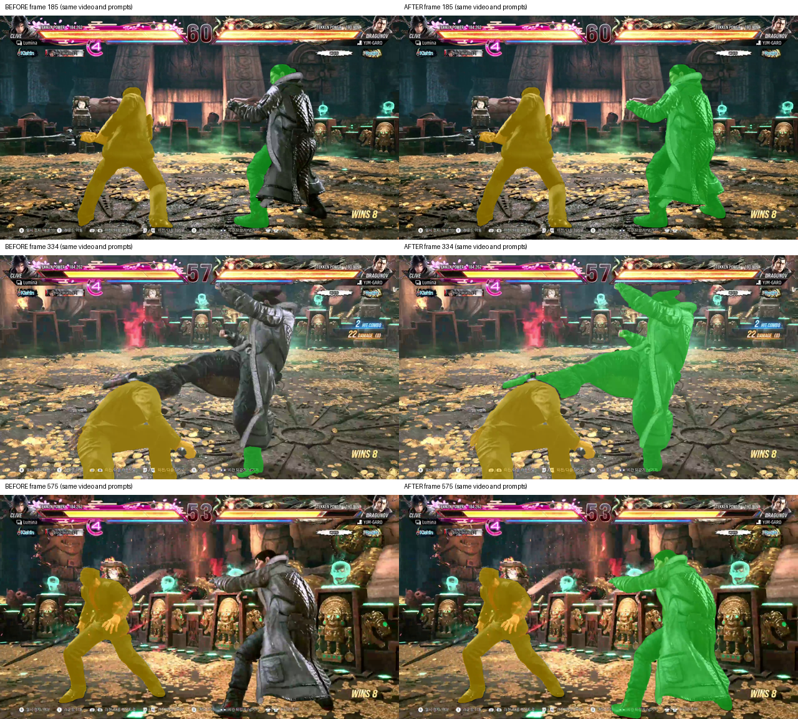
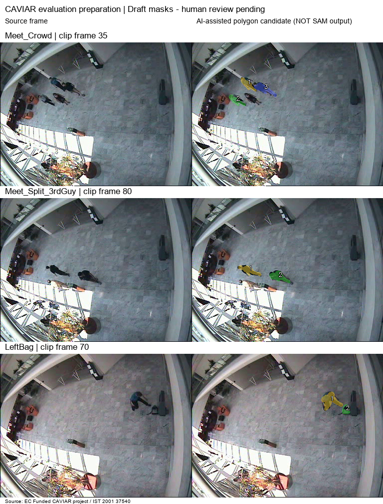
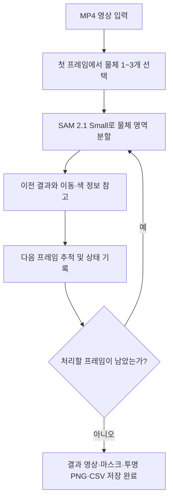

# 1. 프로젝트 개요

## 1.1. 기본 정보

- 프로젝트 제목 : 사용자 선택 기반 영상 객체 분할·추적 시스템
- 작성일자 : 2026년 11월 19일
- 학번 / 이름 : 20221703 / 박준호

본 프로젝트는 저해상도 CCTV에서 사용자가 선택한 작은 물체를 최대 3개까지 분할하고, 움직이는 동안 같은 대상으로 추적하는 프로그램을 만드는 것이다. Python과 사전 학습된 SAM 2.1 Small을 사용하며, SAM 2는 유지하면서 보조 처리의 효과를 확인한다.

# 2. 현재까지 진행된 사항

## 2.1. 데이터 및 개발 환경 구축 현황

- 데이터셋 준비 상태 : 기존 합성 물체 3개·게임 캐릭터 2명 실험에 이어 CAVIAR 공개 CCTV 영상 3개를 확보했다. 평가 구간 3개에서 총 18개 프레임을 고르고, 객체·프레임 기록 42건 중 마스크 후보 39개를 작성했다. 나머지 3건은 가방을 집은 뒤 윤곽이 불분명해 평가에서 제외했다. 현재 마스크 후보는 사람의 경계 검수가 필요한 상태다.
- 데이터 전처리 및 증강 : 원본 MPG를 보존하고 MP4로 변환했다. 평가 구간을 자른 MP4를 고정한 뒤 그 영상에서 PNG를 추출해 주석과 입력 화면을 맞췄다. 이는 화질 향상이나 학습용 증강이 아니며, 재인코딩에 따른 손실이 있다. 공식 XML은 위치·객체 번호 참고용으로만 사용했다.
- 개발 환경 세팅 : Windows, VS Code, Python 3.12.1, PyTorch 2.7.1+cu128, OpenCV 4.12.0, NVIDIA RTX 3060 12GB 환경을 사용한다. 모델은 Hiera 백본의 SAM 2.1 Small이며, 학습이나 파인튜닝은 하지 않았다.

| CCTV 영상 | 선정한 원본 시간 | 평가 영상 길이 | 선택 대상 |
|---|---|---|---|
| Meet_Crowd | 6.00–13.00초 | 175프레임, 7초 | 사람 3명 |
| Meet_Split_3rdGuy | 14.00–22.00초 | 200프레임, 8초 | 사람 2명 |
| LeftBag | 50.00–57.20초 | 180프레임, 7.2초 | 사람 1명과 작은 가방 |

세 구간은 모두 384×288, 25fps이며 총 555프레임·22.2초다. 각 구간에서 6개 프레임씩 선정했다. 같은 로비에서 촬영한 자료이므로 다른 장소의 CCTV 성능까지 대표하지는 않는다. 원본 프레임 번호는 0부터 세며, 구간은 각각 `[150, 325)`, `[350, 550)`, `[1250, 1430)`로 끝 번호를 포함하지 않는다.

자료 출처: EC Funded CAVIAR project / IST 2001 37540, [CAVIAR 공식 자료 페이지](https://homepages.inf.ed.ac.uk/rbf/CAVIARDATA1/). 로비에서 상황을 연기해 촬영한 공개 자료로 실제 범죄 발생 영상은 아니다. 공식 페이지는 CC BY-SA와 출처 표시를 안내하며 버전은 명시하지 않는다.

## 2.2. 모델 개발 및 실험 결과

- 모델 파이프라인 구축 : MP4 입력 → 첫 프레임에서 점·박스로 물체 1–3개 선택 → SAM 2.1 분할·추적 → 이동·색·크기 검사와 보정 → 결과 저장까지 연결했다. 숫자 1·2·3으로 대상을 바꾸며 선택하고 Enter로 처리를 시작한다. 분할 영상, 객체별 마스크·투명 PNG와 추적 상태를 저장한다.
- 초기 실험(베이스라인) 결과 : 10월 30일 게임 캐릭터 2명의 약 50.9초 전체 영상 처리에서 두 대상 모두 최종 놓침이 있었다. 11월 15일에는 같은 입력의 수정 전 코드와 개선 코드를 비교했다. 합성 영상의 평균 IoU와 게임 영상의 일부 지점 포함 결과가 개선됐지만, 이를 CCTV 정확도로 해석하지 않는다. 11월 19일에는 CCTV 평가 자료만 준비했으며 CCTV 모델 추론·정확도 비교는 아직 수행하지 않았다.
- 중간 결과물 예시 : 기존 게임 영상의 코드 수정 전후 비교와 이번 CCTV의 원본·마스크 후보 비교를 아래에 첨부했다. CCTV 그림은 SAM 2의 예측 결과가 아니다.

| 기존 실험 자료·지표 | 수정 전 | 보완 후 | 확인 범위 |
|---|---:|---:|---|
| 합성 물체 3개 평균 IoU | 0.4535 | 0.9674 | 144프레임·6초의 합성 조건. CCTV 결과가 아님 |
| 게임 캐릭터 2번 내부점 포함 | 2/8개 | 8/8개 | 같은 영상의 고정 지점 검사. 전체 경계 정확도가 아님 |
| 게임 영상 처리 시간 | 약 350초 | 약 421초 | 576프레임·9.6초 구간, 각 1회. 모델 로딩·MP4 추출 제외 |

합성 실험은 색·크기 변화 대응 추가 후 0.6737, 재탐색 추가 후 0.8467, 작은 영역 재분할 추가 후 0.9674로 기록됐다. 구간 기준 마스크 갱신을 추가한 뒤에도 평균 0.9674가 유지됐다. 게임 영상의 검사한 배경점 오포함은 수정 전후 모두 0/19개였다. 분할 범위는 개선됐지만 처리 시간은 늘었으며, 수정 코드의 기존 50.9초 전체 재시험은 남아 있다. 이 수치들은 기존 보고서에 기록된 11월 15일 결과이며 이번에 재실행한 결과는 아니다. 합성 비교의 수정 전 기준 코드도 공식 SAM 2 단독 기준과 구분한다.

*그림 1. 11월 15일 게임 영상의 기존 비교 결과. 왼쪽은 기준 마스크 갱신 전, 오른쪽은 수정 후다. 2번 캐릭터의 몸통·코트 누락이 줄었지만 모든 프레임의 경계와 신원을 검증한 결과는 아니다.*

*그림 2. 왼쪽은 CCTV 원본, 오른쪽은 AI 보조로 작성한 마스크 후보다. 위부터 Meet_Crowd의 평가 35번, Meet_Split_3rdGuy의 80번, LeftBag의 70번 프레임이다. 색과 번호는 대상을 구분한다. SAM 2 예측이나 개선 전후 결과가 아니며, 사람의 경계 검수가 필요하다. 영상 출처: EC Funded CAVIAR project / IST 2001 37540.*

CCTV 마스크는 처음 GrabCut으로 초안을 만들었지만 다리 누락과 배경 혼입을 확인해 채택하지 않았다. 이후 원본 확대 화면을 참고해 AI 보조로 다각형 윤곽 후보를 다시 작성했다. SAM 2의 결과를 정답으로 복사하거나 독립적인 사람 작성 정답으로 표현하지 않았다.

평가 영상 555프레임 디코딩, 표본 PNG 18개와 영상의 픽셀 일치, 단일 채널 0·255 마스크 39개, 다각형 재생성, 객체 간 픽셀 중복과 선택 입력 파일을 검사했다. 독립 검토도 통과했지만 이는 후보 준비의 형식·원본 대응 검사이며, 분할 정확도나 확정 정답 승인은 아니다.

세 구간의 첫 프레임에 있는 객체 기록 7건은 초기 선택 확인용으로 분리했다. 이후 35건에서 모호한 가방 3건을 제외하면 채점 후보는 32건이고, 이 중 1건은 화면 이탈의 빈 마스크 후보로 검수가 필요하다. 18개 표본만으로 전체 영상의 IDF1·HOTA나 연속 추적 정확도를 계산하지 않았다.

## 2.3. 이슈 사항

- 발생한 문제 : 작은 물체의 경계와 겹침을 구분하기 어렵고, 기존 게임 영상에서는 대상 일부만 분할되거나 추적이 끊겼다. CCTV 마스크 후보도 사람 검수가 남아 있어 아직 정확도 산출에 사용할 확정 정답은 아니다.
- 원인 분석 : 게임 영상에서는 일부 조각이 다음 구간의 기준으로 계속 전달되는 현상을 확인했다. CCTV에서는 가방 손잡이·다리 사이·밝은 창문 위 경계 등이 불분명했다. CCTV 모델을 실행하지 않았으므로 이 영상의 실제 추적 실패 원인은 아직 확인하지 않았다.
- 해결 방안 : 먼저 원본과 후보를 대조해 정답을 확정하고, 동일 영상·선택 입력으로 SAM 2 단독과 개선본을 비교한다. 식별이 불가능한 표본은 빈 정답과 구분해 제외하고, 추가로 작은 물체의 이동 구간을 확보한다.

LeftBag의 가방은 집히기 전 표본 3개만 남아 있고 초기화 프레임을 제외하면 채점 후보는 2개다. 따라서 이 자료만으로 움직이는 작은 가방을 지속적으로 추적했다고 입증할 수 없다. 화면 가장자리에 잘린 신체도 온전히 보이는 작은 물체와 따로 해석해야 한다.

# 3. 변경 사항

## 3.1. 변경 목표 및 범위

- 변경 전 : 기획안에는 SAM 2.1 Hiera Base+를 교통 영상으로 파인튜닝하고 학습 전후를 비교하는 계획이 있었다. 중간 개발에서는 사전 학습된 Small과 게임·합성 영상으로 기능을 검증했다.
- 변경 후 : 본래 목표인 저해상도 CCTV의 작은 물체 분할·추적에 맞춰 CAVIAR 평가 자료와 마스크 후보를 준비했다. SAM 2는 유지하고 보조 처리의 효과를 같은 CCTV에서 비교하는 방향으로 정리했다.
- 변경 사유 : 게임·합성 영상의 개선만으로 CCTV 성능을 입증할 수 없어 실제 촬영 자료의 정답과 비교 기준이 먼저 필요했다. AI Hub의 로그인 절차 대신 공개 CAVIAR 자료를 사용했다. 파인튜닝은 기본 성능과 실패 원인을 확인한 뒤 필요성을 판단한다.

## 3.2. 변경 방법론 및 아키텍처

- 변경 내용 : SAM 2.1 Small에 연결한 이동·색·크기 검사, 재탐색, 작은 영역 재분할과 구간 기준 마스크 갱신은 유지한다. 이번에는 새 모듈이나 학습을 추가하지 않고, 원본 확인 → 평가 구간·대상 고정 → PNG 추출 → 원본 기반 마스크 후보 작성 → 파일 검사·독립 검토까지 진행했다. 사람 검수와 CCTV 모델 비교는 다음 단계다.

새로 만든 18개 프레임은 평가 후보이므로 그대로 학습에 사용하고 같은 자료에서 오른 점수를 성능 개선으로 제시하지 않는다. 파인튜닝을 검토한다면 별도의 학습·검증 자료와 비용을 먼저 확인한다.

# 4. 향후 계획

## 4.1. 세부 개발 일정

- 9\~10주차 : 원래 11월 2일–11월 15일 계획에 따라 최대 3개 선택·확대를 보강하고 합성·게임 영상 비교를 진행했다.
- 11\~12주차 : 원래 11월 16일–11월 29일 기간 중 11월 19일까지 CCTV 평가 구간과 마스크 후보를 준비했다. 이후 사람 검수, 작은 물체 이동 구간 보완, SAM 2 단독·개선본 비교를 진행할 계획이다. 11월 23일–11월 29일 평가에서는 IoU·Dice·누락·복구와 처리 속도를 정리한다.
- 13\~14주차 : 원래 11월 30일–12월 6일 계획에 따라 비교 표·그래프, 실패 사례와 시연 영상을 정리해 기말 발표 자료를 작성할 계획이다.

향후 비교는 같은 SAM 2.1 Small 가중치·영상·첫 선택 입력을 사용한다. 기준 모델은 공식 SAM 2 영상 예측 조건으로 명확히 정의하며, 현재 프로그램의 옵션 하나를 끈 조건과 같다고 가정하지 않는다. 보조 처리는 하나씩 비교한다.

| 비교 항목 | 평가 방법 | 현재 CCTV 상태 |
|---|---|---|
| IoU·Dice | 검수한 같은 정답 표본에서 경계 겹침 비교, 초기화 프레임 제외 | 미측정 |
| 보이는 대상의 누락 | 검수로 보임이 확인된 표본에서 빈 예측·놓침 확인 | 미측정 |
| 동일 대상 복구 | 연속 구간의 가림·재등장을 추가 확인 | 정답 구간 보완 필요 |
| 처리 시간·FPS | 같은 장비·길이·저장 조건과 측정 범위로 비교 | 미측정 |

기말 PPT에는 기존 모델과 개선본의 같은 프레임 결과, 점수 차이·상대 향상률과 처리 시간을 함께 제시한다. 점수가 좋아지지 않거나 느려진 결과도 구분해 기록한다. 현재 CCTV 성능 향상률과 파인튜닝 효과는 측정하지 않았다.

위 간트차트는 처음 기획안의 날짜를 유지한 계획표다. 날짜가 지났다는 이유로 작업을 완료 처리하지 않으며, 현재는 CCTV 평가 자료의 1차 준비까지 진행한 상태다.
